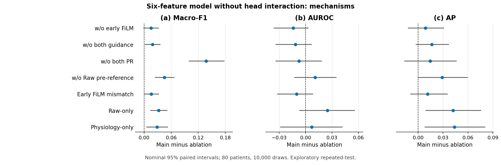
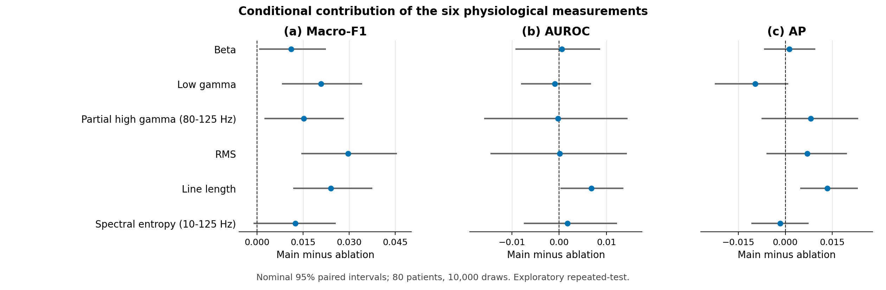

# 六特征、无头部交互主模型：完整五折 Outer 消融

主模型固定为上一版的 w/o Head Interaction，同时永久删除 Variance。保留 β、低γ、80–125 Hz 部分高γ、RMS、Line Length 和10–125 Hz谱熵，形成12个有效摘要坐标。早期 FiLM、晚期 Gate、两类 PR、Raw 发作前参考及64维隐藏单头保持不变。删除的是头部显式 Raw×生理隐藏乘积项；两分支仍经联合 GELU 映射，不能理解成模型完全没有跨分支非线性作用。

本轮14组全部完成原五折及 Outer，合计70个选定折单元：55次真实新增训练，累计670个完整训练轮次，另外15个单元为精确复用。原80人、7,635通道、256次发作、1,471,965个有效 Raw250窗口不变。所有70个模型、预处理、轮次和阈值均在新 Outer 前冻结；全部预测封存后才统一计算指标。

主模型、Raw-only、Physiology-only 各复用五折。复用前检查初始化状态和原内部验证 logits 逐位一致，复用的 Outer 分数及阈值逐字节／哈希核验。其他变体均在无交互的新基准上从匹配的随机初始化重新训练，不沿用旧版含交互消融的结果。

## 1. 患者平均结果

每名患者先独立计算，再对80人等权平均。Macro-F1 是患者内 EZ-F1 与 NEZ-F1 的平均，不是 pooled-channel F1。EZ-Frac. Bias 是预测比例减真实比例，应按接近0解释，不能按有符号差值的正负判优。

| 配置 | Macro-F1 | AUROC | AP | EZ-F1 | NEZ-F1 | ACC | MRR | Top-1 | EZ-Frac. Bias |
| --- | ---: | ---: | ---: | ---: | ---: | ---: | ---: | ---: | ---: |
| 主模型：六特征、无头部交互 | 0.653828 | 0.752255 | 0.585240 | 0.467424 | 0.840232 | 0.770976 | 0.845674 | 0.800000 | -0.022662 |
| w/o Early FiLM | 0.638450 | 0.766268 | 0.576278 | 0.457544 | 0.819355 | 0.747129 | 0.832323 | 0.762500 | 0.003023 |
| w/o Both Guidance | 0.635337 | 0.763667 | 0.568775 | 0.453781 | 0.816893 | 0.743496 | 0.813047 | 0.725000 | 0.005559 |
| w/o 两类 PR | 0.516322 | 0.759725 | 0.570728 | 0.371850 | 0.660795 | 0.662387 | 0.803417 | 0.725000 | 0.129884 |
| w/o Raw Pre-reference | 0.608670 | 0.741359 | 0.556211 | 0.399424 | 0.817916 | 0.744404 | 0.798735 | 0.725000 | -0.024654 |
| Early FiLM 错配 | 0.637951 | 0.762301 | 0.573701 | 0.449240 | 0.826662 | 0.753649 | 0.805629 | 0.725000 | -0.020528 |
| Raw-only | 0.621288 | 0.727387 | 0.543166 | 0.403061 | 0.839516 | 0.761493 | 0.774164 | 0.700000 | -0.067481 |
| Physiology-only | 0.625022 | 0.745238 | 0.541467 | 0.432788 | 0.817256 | 0.746628 | 0.750419 | 0.650000 | -0.004029 |
| 删除 β | 0.642729 | 0.751716 | 0.583951 | 0.462707 | 0.822752 | 0.752023 | 0.844880 | 0.787500 | -0.001311 |
| 删除低γ | 0.632982 | 0.753187 | 0.594837 | 0.450875 | 0.815089 | 0.742093 | 0.848512 | 0.800000 | 0.008469 |
| 删除部分高γ（80–125 Hz） | 0.638606 | 0.752474 | 0.577113 | 0.440225 | 0.836987 | 0.762240 | 0.832408 | 0.775000 | -0.040450 |
| 删除 RMS | 0.624215 | 0.752131 | 0.578262 | 0.435301 | 0.813130 | 0.735770 | 0.810425 | 0.750000 | 0.002387 |
| 删除 Line Length | 0.629786 | 0.745476 | 0.571816 | 0.429622 | 0.829951 | 0.756658 | 0.830043 | 0.775000 | -0.041672 |
| 删除谱熵（10–125 Hz） | 0.641416 | 0.750527 | 0.586901 | 0.446435 | 0.836397 | 0.762345 | 0.839559 | 0.787500 | -0.028807 |

完整精度见[MAIN_RESULTS.csv](results/MAIN_RESULTS.csv)。[Pooled指标](results/POOLED_RESULTS.csv)单独列出，不代替上表。

## 2. 患者配对不确定性

差值统一为主模型减消融。以下只比较 Macro-F1，因此正值有利于主模型。固定 seed42、同一80人、10,000次患者级配对 bootstrap；13项额外区间采用 Bonferroni 水平的百分位尾概率0.05/(2×13)，属于近似探索性校正，不覆盖整个历史研究过程的选择效应。

| 对照 | Macro-F1 差值 | 名义95%区间 | 额外13项比较区间 |
| --- | ---: | --- | --- |
| w/o Early FiLM | +0.015378 | [-0.001511, 0.032717] | [-0.009135, 0.042521] |
| w/o Both Guidance | +0.018491 | [0.001508, 0.036205] | [-0.006033, 0.044342] |
| w/o 两类 PR | +0.137506 | [0.098996, 0.178225] | [0.083062, 0.198608] |
| w/o Raw Pre-reference | +0.045158 | [0.023842, 0.067260] | [0.015097, 0.077543] |
| Early FiLM 错配 | +0.015877 | [-0.000486, 0.032985] | [-0.007845, 0.040435] |
| Raw-only | +0.032540 | [0.013752, 0.051842] | [0.004185, 0.061329] |
| Physiology-only | +0.028806 | [0.004830, 0.052839] | [-0.006101, 0.064140] |
| 删除 β | +0.011099 | [0.000712, 0.022413] | [-0.003575, 0.028097] |
| 删除低γ | +0.020845 | [0.008061, 0.034166] | [0.001578, 0.040766] |
| 删除部分高γ（80–125 Hz） | +0.015222 | [0.002425, 0.028256] | [-0.003658, 0.034857] |
| 删除 RMS | +0.029612 | [0.014411, 0.045555] | [0.007526, 0.052802] |
| 删除 Line Length | +0.024041 | [0.011733, 0.037474] | [0.006459, 0.044566] |
| 删除谱熵（10–125 Hz） | +0.012412 | [-0.001149, 0.025607] | [-0.007547, 0.032996] |

额外13项比较区间完整高于0的对照：w/o 两类 PR、w/o Raw Pre-reference、Raw-only、删除低γ、删除 RMS、删除 Line Length。
额外13项比较区间完整低于0的对照：无。
区间包含0的对照：w/o Early FiLM、w/o Both Guidance、Early FiLM 错配、Physiology-only、删除 β、删除部分高γ（80–125 Hz）、删除谱熵（10–125 Hz）。这些分类只描述本轮固定模型预测下的患者配对差异，不据此重新选择主模型或开展下一轮筛选。

[全部243项名义区间](results/INTERVALS.csv)包含14组绝对结果和13组配对差值的全部九项指标；[额外13项Macro-F1区间](results/MACRO_FAMILY_INTERVALS.csv)单独提供。

本轮对两类 PR、Raw 发作前参考，以及相对 Raw-only 的显式生理增量，提供了区间未跨0的 Macro-F1 对比。相对 Physiology-only 的增量在额外13项比较区间下仍包含0，不能把两个方向的分支互补都写成已确证。早期 FiLM 删除、联合引导删除和早期错配的额外区间也包含0，当前证据不足以确证这些引导机制。

去掉两类 PR 后，AUROC 为0.759725，但 Macro-F1 降为0.516322，NEZ-F1 降为0.660795，EZ比例偏差变为+0.129884。排序能力与按冻结阈值形成的错误类型并不相同；AUROC较高不能抵消F1和预测EZ比例的恶化。

单项特征证据中，低γ、RMS、Line Length 的 Macro-F1 条件贡献在额外区间下仍为正；β、部分高γ和谱熵尚不能排除零差异。不过删除低γ后的AP为0.594837，高于主模型的0.585240。因此保留特征的依据具有指标依赖性，不能将六项组合描述为所有指标上的最佳方案。

## 3. 模块、容量与特征解释

w/o PR 同时取消14D生理摘要的患者内 Z 和最终96D Raw摘要的患者内 Z；不取消单窗口波形归一化、Raw参考扣除或原始 DELTA 定义。内部验证仍按原规则选轮次和阈值。AUROC/AP 与阈值型 F1 的变化应分别讨论，不能用排序指标相近推断分类决策相同。

错配仅改变早期 FiLM 的供体轨迹，限制在同患者、同发作、完整有效窗口掩码相同的通道组；晚期 Gate 和直接生理输入保持正确对应。参数数与主模型相同。单通道组不改变，覆盖统计见[RAW_COVERAGE.csv](results/RAW_COVERAGE.csv)。

| 配置 | 参数量 | 新增训练折数 | 精确复用折数 |
| --- | ---: | ---: | ---: |
| 主模型：六特征、无头部交互 | 11425 | 0 | 5 |
| w/o Early FiLM | 10377 | 5 | 0 |
| w/o Both Guidance | 9329 | 5 | 0 |
| w/o 两类 PR | 11425 | 5 | 0 |
| w/o Raw Pre-reference | 11425 | 5 | 0 |
| Early FiLM 错配 | 11425 | 5 | 0 |
| Raw-only | 8433 | 0 | 5 |
| Physiology-only | 1025 | 0 | 5 |
| 删除 β | 11425 | 5 | 0 |
| 删除低γ | 11425 | 5 | 0 |
| 删除部分高γ（80–125 Hz） | 11425 | 5 | 0 |
| 删除 RMS | 11425 | 5 | 0 |
| 删除 Line Length | 11425 | 5 | 0 |
| 删除谱熵（10–125 Hz） | 11425 | 5 | 0 |

Raw-only、Physiology-only 采用完整初始化中相应的输入权重切片、原缩放及64维隐藏头，不另加宽。分支或模块移除改变参数容量时，性能差异包含容量与优化效应，不能全部解释为信息差异。

六项单删同步屏蔽两个摘要坐标及早期 FiLM、晚期 Gate 对应窗口坐标，并从头训练。剩余显式生理属性为五项，Variance 始终未参与。单删评估的是在其余特征和 Raw 分支存在时的条件预测贡献；Raw 可能补偿被删属性，不能将零差异写成该生理属性无效，也不能由六个单删证明当前组合全局最优。

按用户要求，本轮不做孤立 Late Gate 删除，也不做 Head Interaction 加回。因此不报告早期／晚期引导的完整四格交互。

## 4. 五折与来源稳定性

| 配置 | Macro-F1折间SD | AUROC折间SD | AP折间SD |
| --- | ---: | ---: | ---: |
| 主模型：六特征、无头部交互 | 0.032932 | 0.039583 | 0.045557 |
| w/o Early FiLM | 0.040809 | 0.057142 | 0.054278 |
| w/o Both Guidance | 0.036695 | 0.055059 | 0.032672 |
| w/o 两类 PR | 0.040996 | 0.030234 | 0.075678 |
| w/o Raw Pre-reference | 0.049699 | 0.047694 | 0.057782 |
| Early FiLM 错配 | 0.039928 | 0.057563 | 0.030288 |
| Raw-only | 0.033264 | 0.042621 | 0.058119 |
| Physiology-only | 0.039743 | 0.058997 | 0.055830 |
| 删除 β | 0.038911 | 0.049193 | 0.048625 |
| 删除低γ | 0.043818 | 0.043938 | 0.057884 |
| 删除部分高γ（80–125 Hz） | 0.041888 | 0.035502 | 0.043568 |
| 删除 RMS | 0.032942 | 0.047102 | 0.046297 |
| 删除 Line Length | 0.027996 | 0.033551 | 0.026348 |
| 删除谱熵（10–125 Hz） | 0.032195 | 0.042956 | 0.040989 |

[五折全部九指标](results/FOLD_RESULTS.csv)、[全部折间样本标准差](results/FOLD_SD.csv)、[跨来源结果](results/SOURCE_RESULTS.csv)、[指标覆盖](results/METRIC_COVERAGE.csv)均独立列出。五折训练集有重叠，折间SD是描述性稳定性，不代表五次独立随机种子试验。来源患者数少于5时抑制指标，不删除这些患者。

## 5. 传统分类器：复用的六特征参考

以下七类分类器×有／无 Feature PR 来自上一版实际完成的同队列六特征实验。神经头部交互的删除不影响它们的12D输入或模型；本轮不重复训练，也不将其列入上述14组区间族。SVM校准、FIT-only预处理和原内部验证阈值保持原样。

| 分类器 | Macro-F1 | AUROC | AP | EZ-F1 | NEZ-F1 | ACC | MRR | Top-1 | EZ-Frac. Bias |
| --- | ---: | ---: | ---: | ---: | ---: | ---: | ---: | ---: | ---: |
| LogisticRegression_NO_PR | 0.490459 | 0.673760 | 0.473127 | 0.354306 | 0.626612 | 0.627024 | 0.659387 | 0.562500 | 0.180506 |
| LogisticRegression_PR | 0.616855 | 0.744239 | 0.542991 | 0.414733 | 0.818976 | 0.744668 | 0.729665 | 0.625000 | -0.021231 |
| Linear_SVM_NO_PR | 0.460636 | 0.686548 | 0.481612 | 0.287300 | 0.633971 | 0.641928 | 0.648263 | 0.537500 | 0.147331 |
| Linear_SVM_PR | 0.624661 | 0.743583 | 0.543185 | 0.452126 | 0.797196 | 0.722801 | 0.738760 | 0.650000 | 0.044136 |
| RBF_SVM_NO_PR | 0.489375 | 0.675847 | 0.475599 | 0.340246 | 0.638505 | 0.639097 | 0.660491 | 0.537500 | 0.136671 |
| RBF_SVM_PR | 0.620269 | 0.739604 | 0.528314 | 0.419466 | 0.821073 | 0.751595 | 0.687611 | 0.550000 | -0.009963 |
| RandomForest_NO_PR | 0.487058 | 0.609472 | 0.427605 | 0.313197 | 0.660918 | 0.629465 | 0.617382 | 0.500000 | 0.127964 |
| RandomForest_PR | 0.597245 | 0.711398 | 0.509964 | 0.374616 | 0.819873 | 0.748965 | 0.682932 | 0.600000 | -0.032072 |
| XGBoost_NO_PR | 0.517104 | 0.630224 | 0.449100 | 0.307905 | 0.726303 | 0.676670 | 0.640475 | 0.525000 | 0.051863 |
| XGBoost_PR | 0.592552 | 0.714219 | 0.515371 | 0.370177 | 0.814926 | 0.744472 | 0.734400 | 0.637500 | -0.036768 |
| MLP_NO_PR | 0.496688 | 0.661085 | 0.476285 | 0.300132 | 0.693244 | 0.656549 | 0.683931 | 0.587500 | 0.078268 |
| MLP_PR | 0.602087 | 0.715250 | 0.511915 | 0.398594 | 0.805580 | 0.731261 | 0.705578 | 0.575000 | -0.002167 |
| AdaBoost_NO_PR | 0.493604 | 0.649341 | 0.422868 | 0.309595 | 0.677613 | 0.649711 | 0.670123 | 0.550000 | 0.089346 |
| AdaBoost_PR | 0.618296 | 0.740232 | 0.525859 | 0.428933 | 0.807660 | 0.741833 | 0.711091 | 0.600000 | 0.014463 |

这些基线沿用此前合法验证选定的固定超参数，不是对12D重新穷举优化。原10个MLP拟合均在400次迭代预算内记录 ConvergenceWarning，不能称作已证明优化收敛；本轮未据结果追加迭代。原始来源与哈希见[复用审计](results/HISTORICAL_CLASSIFIER_AUDIT.json)。

## 6. 证据边界与核验

独立重算1120行患者结果、10080个指标值，核验243个名义区间、13个额外区间、pooled指标、五折及来源汇总、所有有效窗口覆盖和15个复用预测。独立区间最大数值差为5.55e-16。

本轮主模型选择发生在既往 Outer 多次查看之后，所有结论均为探索性重复测试，不是独立确认。没有根据本轮 Outer 更改模型、阈值或筛选规则。固定一个seed不足以证明训练随机性稳定，也不能据此声称最优特征集合或外部中心泛化。

代码、匿名汇总、区间、图和执行审计上传 GitHub；原始波形、患者／通道身份、逐例预测、权重、预处理器、缓存及日志保留在可信服务器。
