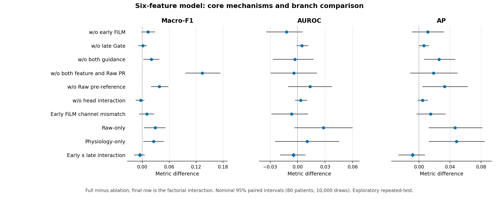
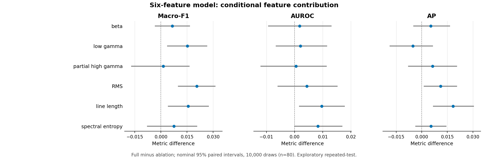
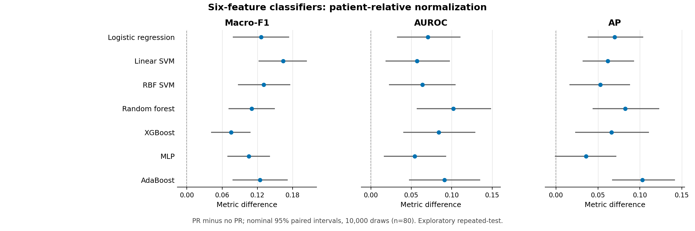

# F0 without Variance: complete ablations and classical classifiers

Actual completed experiment: sixteen neural configurations plus seven classifiers in two PR settings, each over all five original patient-held-out folds. The cohort remains80patients/7635channels/256seizures. All150selected models froze before newOuter; all150score cells sealed before metric reporting.

The full six-feature model and Raw-only reuse ten exact previously frozen cells;70neural fits and70classical models are genuinely new. The main model was chosen by the user after historical Outer viewing: every conclusion is exploratory repeated-test, not independent confirmation. No new model or threshold was chosen from this Outer pass.

## Patient-average primary results

Each row is an equal mean of80patient metrics. Macro-F1 is the mean of EZ-F1 and NEZ-F1, not pooled-channel F1. EZ-fraction bias is predicted minus true fraction; closer to zero is preferable.

### Neural mechanisms and six feature deletions

| Configuration | Macro-F1 | AUROC | AP | EZ-F1 | NEZ-F1 | ACC | MRR | Top-1 | EZ-frac. bias |
| --- | ---: | ---: | ---: | ---: | ---: | ---: | ---: | ---: | ---: |
| Full six-feature F0 | 0.650225 | 0.755579 | 0.589825 | 0.471029 | 0.829421 | 0.761246 | 0.829984 | 0.775000 | -0.013162 |
| w/o early FiLM | 0.637216 | 0.767769 | 0.578482 | 0.456003 | 0.818429 | 0.745889 | 0.832308 | 0.762500 | 0.006348 |
| w/o late Gate | 0.648639 | 0.751070 | 0.583686 | 0.459567 | 0.837712 | 0.766632 | 0.838366 | 0.787500 | -0.022694 |
| w/o both guidance | 0.630096 | 0.758617 | 0.563962 | 0.443507 | 0.816685 | 0.741857 | 0.821247 | 0.725000 | -0.002356 |
| w/o both feature and Raw PR | 0.516423 | 0.759815 | 0.571055 | 0.372020 | 0.660826 | 0.662552 | 0.809667 | 0.737500 | 0.130048 |
| w/o Raw pre-reference | 0.611990 | 0.742117 | 0.556857 | 0.405675 | 0.818305 | 0.745262 | 0.798909 | 0.725000 | -0.022065 |
| w/o head interaction | 0.653828 | 0.752255 | 0.585240 | 0.467424 | 0.840232 | 0.770976 | 0.845674 | 0.800000 | -0.022662 |
| Early FiLM channel mismatch | 0.639953 | 0.762132 | 0.574723 | 0.442431 | 0.837474 | 0.763342 | 0.806650 | 0.725000 | -0.035977 |
| Raw-only | 0.621288 | 0.727387 | 0.543166 | 0.403061 | 0.839516 | 0.761493 | 0.774164 | 0.700000 | -0.067481 |
| Physiology-only | 0.625022 | 0.745238 | 0.541467 | 0.432788 | 0.817256 | 0.746628 | 0.750419 | 0.650000 | -0.004029 |
| Drop beta | 0.643728 | 0.753811 | 0.584484 | 0.462706 | 0.824749 | 0.754182 | 0.851141 | 0.800000 | -0.005167 |
| Drop low gamma | 0.635054 | 0.753538 | 0.595016 | 0.453285 | 0.816823 | 0.744769 | 0.855363 | 0.812500 | 0.006000 |
| Drop partial high gamma | 0.648897 | 0.755063 | 0.583517 | 0.458448 | 0.839347 | 0.766726 | 0.844606 | 0.787500 | -0.033404 |
| Drop RMS | 0.629653 | 0.751224 | 0.578798 | 0.440939 | 0.818367 | 0.743584 | 0.812800 | 0.750000 | -0.007512 |
| Drop line length | 0.634608 | 0.745935 | 0.571474 | 0.439036 | 0.830180 | 0.758524 | 0.835641 | 0.787500 | -0.035595 |
| Drop spectral entropy | 0.642752 | 0.747314 | 0.584456 | 0.449398 | 0.836105 | 0.762616 | 0.835558 | 0.787500 | -0.025082 |

### Other classifiers: exact same12physiological summary coordinates

| Configuration | Macro-F1 | AUROC | AP | EZ-F1 | NEZ-F1 | ACC | MRR | Top-1 | EZ-frac. bias |
| --- | ---: | ---: | ---: | ---: | ---: | ---: | ---: | ---: | ---: |
| Logistic regression without PR | 0.490459 | 0.673760 | 0.473127 | 0.354306 | 0.626612 | 0.627024 | 0.659387 | 0.562500 | 0.180506 |
| Logistic regression with PR | 0.616855 | 0.744239 | 0.542991 | 0.414733 | 0.818976 | 0.744668 | 0.729665 | 0.625000 | -0.021231 |
| Linear SVM without PR | 0.460636 | 0.686548 | 0.481612 | 0.287300 | 0.633971 | 0.641928 | 0.648263 | 0.537500 | 0.147331 |
| Linear SVM with PR | 0.624661 | 0.743583 | 0.543185 | 0.452126 | 0.797196 | 0.722801 | 0.738760 | 0.650000 | 0.044136 |
| RBF SVM without PR | 0.489375 | 0.675847 | 0.475599 | 0.340246 | 0.638505 | 0.639097 | 0.660491 | 0.537500 | 0.136671 |
| RBF SVM with PR | 0.620269 | 0.739604 | 0.528314 | 0.419466 | 0.821073 | 0.751595 | 0.687611 | 0.550000 | -0.009963 |
| Random forest without PR | 0.487058 | 0.609472 | 0.427605 | 0.313197 | 0.660918 | 0.629465 | 0.617382 | 0.500000 | 0.127964 |
| Random forest with PR | 0.597245 | 0.711398 | 0.509964 | 0.374616 | 0.819873 | 0.748965 | 0.682932 | 0.600000 | -0.032072 |
| XGBoost without PR | 0.517104 | 0.630224 | 0.449100 | 0.307905 | 0.726303 | 0.676670 | 0.640475 | 0.525000 | 0.051863 |
| XGBoost with PR | 0.592552 | 0.714219 | 0.515371 | 0.370177 | 0.814926 | 0.744472 | 0.734400 | 0.637500 | -0.036768 |
| MLP without PR | 0.496688 | 0.661085 | 0.476285 | 0.300132 | 0.693244 | 0.656549 | 0.683931 | 0.587500 | 0.078268 |
| MLP with PR | 0.602087 | 0.715250 | 0.511915 | 0.398594 | 0.805580 | 0.731261 | 0.705578 | 0.575000 | -0.002167 |
| AdaBoost without PR | 0.493604 | 0.649341 | 0.422868 | 0.309595 | 0.677613 | 0.649711 | 0.670123 | 0.550000 | 0.089346 |
| AdaBoost with PR | 0.618296 | 0.740232 | 0.525859 | 0.428933 | 0.807660 | 0.741833 | 0.711091 | 0.600000 | 0.014463 |

Training warnings: 10/70 classical fits recorded warning categories. See [training records](TABULAR_TRAIN_CELLS.csv); the fixed MLP400-iteration budget was not enlarged after outcomes. Reaching the budget is not evidence of optimization convergence.

Unrounded [main results](MAIN_RESULTS.csv); separate [pooled](POOLED_RESULTS.csv), [folds](FOLD_RESULTS.csv), [fold SD](FOLD_SD.csv), [sources](SOURCE_RESULTS.csv) and [coverage](METRIC_COVERAGE.csv). All group rows, including worse outcomes, remain reported.

## Paired uncertainty

Same80patient resampling indices,10000draws,seed42.603nominal intervals cover30absolute estimates,29Full-minus-other comparisons,one guidance interaction and7classifier PR differences across9metrics.37additional Macro-F1 intervals use Bonferroni-level percentile tails .05/(2x37); these are approximate exploratory summaries, not exact family-error guarantees or correction for the entire historical research sequence.

| Contrast | Macro-F1 difference | Nominal95% interval | Additional37-comparison interval |
| --- | ---: | --- | --- |
| FULL_minus_WO_EARLY_FILM | +0.013009 | [-0.001920, 0.028298] | [-0.011538, 0.038228] |
| FULL_minus_WO_LATE_GATE | +0.001586 | [-0.009016, 0.009917] | [-0.018937, 0.014637] |
| FULL_minus_WO_BOTH_GUIDANCE | +0.020129 | [0.002229, 0.038060] | [-0.009283, 0.049006] |
| FULL_minus_WO_BOTH_PR | +0.133802 | [0.096460, 0.174438] | [0.072388, 0.200395] |
| FULL_minus_WO_RAW_PRE_REFERENCE | +0.038235 | [0.019377, 0.058091] | [0.007742, 0.072742] |
| FULL_minus_WO_HEAD_INTERACTION | -0.003603 | [-0.014455, 0.004732] | [-0.024040, 0.008660] |
| FULL_minus_EARLY_FILM_MISMATCH | +0.010272 | [-0.007258, 0.026540] | [-0.017991, 0.036633] |
| FULL_minus_RAW_ONLY | +0.028937 | [0.003864, 0.051831] | [-0.014481, 0.065403] |
| FULL_minus_PHYSIOLOGY_ONLY | +0.025203 | [0.002454, 0.048062] | [-0.014200, 0.061568] |
| FULL_minus_DROP_BETA | +0.006497 | [-0.003546, 0.016727] | [-0.008941, 0.023527] |
| FULL_minus_DROP_LOW_GAMMA | +0.015171 | [0.003511, 0.026570] | [-0.003507, 0.034490] |
| FULL_minus_DROP_PARTIAL_HIGH_GAMMA | +0.001328 | [-0.017081, 0.016483] | [-0.033869, 0.024800] |
| FULL_minus_DROP_RMS | +0.020572 | [0.009798, 0.031371] | [0.003980, 0.038552] |
| FULL_minus_DROP_LINE_LENGTH | +0.015617 | [0.004002, 0.027525] | [-0.002757, 0.035355] |
| FULL_minus_DROP_SPECTRAL_ENTROPY | +0.007473 | [-0.008005, 0.020872] | [-0.019136, 0.030297] |
| FULL_minus_LogisticRegression_NO_PR | +0.159766 | [0.112145, 0.207240] | [0.080597, 0.237442] |
| FULL_minus_LogisticRegression_PR | +0.033370 | [0.007760, 0.059929] | [-0.006489, 0.076228] |
| FULL_minus_Linear_SVM_NO_PR | +0.189589 | [0.147461, 0.232312] | [0.115259, 0.258345] |
| FULL_minus_Linear_SVM_PR | +0.025564 | [0.000653, 0.051170] | [-0.015697, 0.067083] |
| FULL_minus_RBF_SVM_NO_PR | +0.160849 | [0.117436, 0.205865] | [0.092584, 0.234301] |
| FULL_minus_RBF_SVM_PR | +0.029956 | [0.003271, 0.055837] | [-0.015152, 0.072411] |
| FULL_minus_RandomForest_NO_PR | +0.163167 | [0.124452, 0.204199] | [0.102724, 0.229892] |
| FULL_minus_RandomForest_PR | +0.052980 | [0.025373, 0.081067] | [0.008382, 0.095522] |
| FULL_minus_XGBoost_NO_PR | +0.133121 | [0.097080, 0.168991] | [0.076537, 0.192597] |
| FULL_minus_XGBoost_PR | +0.057673 | [0.029176, 0.086173] | [0.013055, 0.102098] |
| FULL_minus_MLP_NO_PR | +0.153537 | [0.117620, 0.190054] | [0.095133, 0.217045] |
| FULL_minus_MLP_PR | +0.048138 | [0.021554, 0.074678] | [0.006799, 0.087922] |
| FULL_minus_AdaBoost_NO_PR | +0.156621 | [0.112655, 0.202062] | [0.086449, 0.234581] |
| FULL_minus_AdaBoost_PR | +0.031929 | [0.004959, 0.058286] | [-0.012562, 0.073578] |
| Early_by_late_guidance | -0.005535 | [-0.018184, 0.005742] | [-0.027519, 0.013562] |
| LogisticRegression_PR_minus_NO_PR | +0.126396 | [0.078408, 0.174013] | [0.045494, 0.200759] |
| Linear_SVM_PR_minus_NO_PR | +0.164026 | [0.121844, 0.204468] | [0.093664, 0.228333] |
| RBF_SVM_PR_minus_NO_PR | +0.130894 | [0.086754, 0.175998] | [0.060524, 0.206089] |
| RandomForest_PR_minus_NO_PR | +0.110187 | [0.070931, 0.149772] | [0.045805, 0.170446] |
| XGBoost_PR_minus_NO_PR | +0.075447 | [0.041333, 0.108443] | [0.021079, 0.130415] |
| MLP_PR_minus_NO_PR | +0.105399 | [0.068866, 0.141364] | [0.046296, 0.165712] |
| AdaBoost_PR_minus_NO_PR | +0.124692 | [0.077913, 0.171487] | [0.045721, 0.204427] |

[All603nominal intervals](INTERVALS.csv) and [all37Macro-F1 family intervals](MACRO_FAMILY_INTERVALS.csv). Positive Full-minus-other favors Full; positive classifier PR-minus-noPR favors PR. Guidance interaction is Full+Neither-NoEarly-NoLate.

## Core mechanisms

NoBothPR simultaneously removes direct physiological-summary patient Z and final96D Raw-summary patient Z. It does not disable per-window waveform normalization, the pre-reference, either conditioning module or the physiological DELTA definition. There are no separate single-branch PR ablations in this new matrix. Other switches preserve their original operation boundaries and full initializer before deletion.

The early FiLM mismatch remains within patient/seizure/identical valid-window-support groups. Only earlyconditioning receives donor trajectories; correctly aligned direct physiology and late Gate stay intact. Variance is masked for both recipient and donor. Counts are in [RAW_COVERAGE.csv](RAW_COVERAGE.csv). Same parameter count is a control for capacity, not proof against every alternative architecture.

## Remaining six explicit inputs

Variance is masked permanently in every neural physiology path. Each additional deletion is trained from the matched fresh initialization and removes the corresponding two summary coordinates and early/late window coordinate; widths remain14/7. Thus single deletions have five active measurements, not six plus hidden Variance. Raw can still encode correlated properties; no single-deletion result proves absence of the physiology or optimality of the retained subset. Partial high gamma is80–125Hz and entropy10–125Hz, never full80–150Hz or recovered low frequencies.

## Classical PR comparison

Classifiers actually receive12columns: the two summaries of each remaining measurement. NoPR uses the original DELTA summary values, PR uses original label-free within-patient population Z, followed by unchanged FIT-only preprocessing. Shared model/fold hyperparameters come from the old legally validation-selected7-feature configurations and are frozen across both12D arms; there is no new search. This is a fixed-hyperparameter transfer comparison, not proof that every classifier is optimally tuned for12D. All70models are newly fitted on legalFIT only; no trained7Dclassifier is relabeled as12D.

LR, SVM and MLP use FIT-only scaling; tree models retain native unscaled inputs. SVM probabilities use3patient-held-out subfolds strictly insideFIT for Platt calibration. Validation only selects each numeric threshold; it never calibrates SVM or refits the model. Classifiers have no Raw branch, so their PR switch refers only to the12D physiological input. Their original EZ>=threshold decision rule and the neural NEZ<threshold rule are preserved without rounding scores.

## Completeness and boundaries

- Independently checked 2400 patient rows and 21600 endpoints,603nominal and37additional family intervals. Maximum interval difference 8.88e-16.
- All groups retain80patients and7635channels. Each of13new Raw-consuming arms retains1471965valid windows. Physiology-only and tabular models consume no Raw during inference; no fabricated Raw counts are assigned.
- The same seed42, five folds, source roles, full-patient neural updates, FP32 settings, optimizer/loss and epoch/threshold rules were preserved. Every configuration completes Outer regardless of validation performance.
- One fixed seed does not establish seed robustness; patient bootstrap does not cover researcher selection, the main model choice or training randomness. Cross-source tables are descriptive on the same historical cohort.
- Results may be negative or metric-dependent; no reduced subset or updated method is selected from this pass. Full-versus-branch differences can include parameter-capacity/optimization differences, not only pure information content.
- Only source/hashes and anonymous aggregate tables/figures are released. Signals, identities, individual predictions, weights, preprocessors, maps and logs stay on the trusted server.
