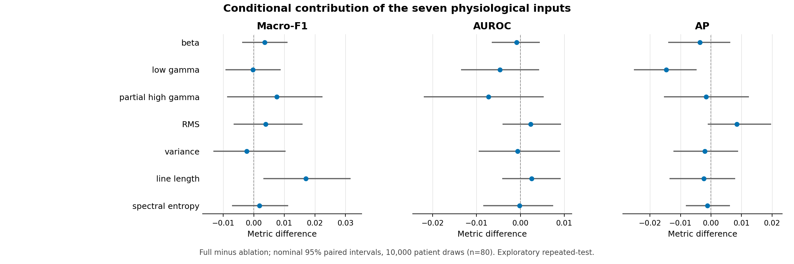
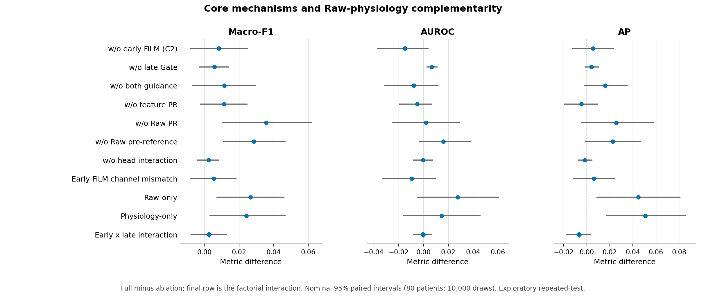

# F0 single-head complete ablation: seed42 five-fold Outer

All eighteen configurations completed the original patient-held-out five folds: 80 patients, 7,635 channels and256seizures. Sixteen arms were freshly trained in80fold cells; frozen F0/C2 contributed ten exact reused cells. No Development eligibility screen or Outer-driven tuning was applied.

The primary endpoint is the equal-patient mean binary Macro-F1 over all80patients, not pooled-channel F1 or an equal-weight five-fold average. The same seven measurements are retained for the full model; explicit leave-one-out masks act in all three physiology input paths.

## All fixed configurations

| Configuration | Macro-F1 | AUROC | AP | EZ-F1 | NEZ-F1 | ACC | MRR | Top-1 | EZ-frac. bias |
| --- | ---: | ---: | ---: | ---: | ---: | ---: | ---: | ---: | ---: |
| Full F0 | 0.647977 | 0.754932 | 0.587757 | 0.453985 | 0.841968 | 0.770914 | 0.831379 | 0.775000 | -0.041987 |
| w/o early FiLM (C2) | 0.639658 | 0.769704 | 0.582443 | 0.448853 | 0.830463 | 0.758853 | 0.803898 | 0.712500 | -0.026113 |
| w/o late Gate | 0.642099 | 0.748302 | 0.583657 | 0.449340 | 0.834859 | 0.761412 | 0.830321 | 0.775000 | -0.024646 |
| w/o both guidance | 0.636422 | 0.762789 | 0.571705 | 0.451642 | 0.821203 | 0.749182 | 0.806389 | 0.712500 | -0.004290 |
| w/o feature PR | 0.636630 | 0.760019 | 0.592555 | 0.437262 | 0.835999 | 0.763691 | 0.816212 | 0.750000 | -0.043180 |
| w/o Raw PR | 0.612241 | 0.752865 | 0.562179 | 0.422700 | 0.801781 | 0.741412 | 0.774804 | 0.687500 | -0.011523 |
| w/o Raw pre-reference | 0.619383 | 0.738774 | 0.565261 | 0.417472 | 0.821293 | 0.748855 | 0.788117 | 0.700000 | -0.022854 |
| w/o head interaction | 0.645519 | 0.755232 | 0.589388 | 0.447467 | 0.843572 | 0.771636 | 0.830527 | 0.775000 | -0.052331 |
| Early FiLM channel mismatch | 0.642482 | 0.764459 | 0.581755 | 0.453234 | 0.831730 | 0.759179 | 0.804533 | 0.725000 | -0.017460 |
| Raw-only | 0.621288 | 0.727387 | 0.543166 | 0.403061 | 0.839516 | 0.761493 | 0.774164 | 0.700000 | -0.067481 |
| Physiology-only | 0.623705 | 0.740277 | 0.537137 | 0.427090 | 0.820321 | 0.745545 | 0.741429 | 0.637500 | -0.016154 |
| Drop beta | 0.644374 | 0.755813 | 0.591436 | 0.452202 | 0.836546 | 0.765005 | 0.834560 | 0.787500 | -0.029909 |
| Drop low gamma | 0.648238 | 0.759562 | 0.602394 | 0.459764 | 0.836712 | 0.766810 | 0.843635 | 0.800000 | -0.025379 |
| Drop partial high gamma | 0.640417 | 0.762180 | 0.589334 | 0.449237 | 0.831596 | 0.758198 | 0.842031 | 0.787500 | -0.025200 |
| Drop RMS | 0.644116 | 0.752607 | 0.579294 | 0.457626 | 0.830606 | 0.761260 | 0.788213 | 0.712500 | -0.025281 |
| Drop variance | 0.650225 | 0.755579 | 0.589825 | 0.471029 | 0.829421 | 0.761246 | 0.829984 | 0.775000 | -0.013162 |
| Drop line length | 0.630903 | 0.752404 | 0.590149 | 0.429153 | 0.832654 | 0.761347 | 0.850033 | 0.812500 | -0.056653 |
| Drop spectral entropy | 0.646062 | 0.755094 | 0.588886 | 0.455993 | 0.836130 | 0.766366 | 0.832497 | 0.775000 | -0.026270 |

Unrounded values: [MAIN_RESULTS.csv](MAIN_RESULTS.csv). All80patients contribute to each arm; undefined-value coverage is explicitly audited, not replaced by favorable zeros. Separate [pooled](POOLED_RESULTS.csv), [fold](FOLD_RESULTS.csv), [fold SD](FOLD_SD.csv) and [source](SOURCE_RESULTS.csv) tables preserve their distinct aggregation units.

## Paired differences from the complete F0

Positive Full-minus-ablation means the complete model scores higher. These are fixed-model, seed42 patient-paired percentile intervals; they do not include model-selection or seed uncertainty.

| Comparison | Macro-F1 difference | Nominal95% CI | Additional18-comparison family interval |
| --- | ---: | --- | --- |
| Full minus w/o early FiLM (C2) | +0.008319 | [-0.008144, 0.025137] | [-0.015701, 0.034496] |
| Full minus w/o late Gate | +0.005877 | [-0.003032, 0.014456] | [-0.007648, 0.018629] |
| Full minus w/o both guidance | +0.011554 | [-0.006954, 0.029919] | [-0.015883, 0.040062] |
| Full minus w/o feature PR | +0.011346 | [-0.002560, 0.024972] | [-0.009479, 0.031077] |
| Full minus w/o Raw PR | +0.035736 | [0.010005, 0.062084] | [-0.003528, 0.074896] |
| Full minus w/o Raw pre-reference | +0.028594 | [0.010679, 0.046990] | [0.000963, 0.058353] |
| Full minus w/o head interaction | +0.002457 | [-0.004362, 0.008513] | [-0.008433, 0.011483] |
| Full minus Early FiLM channel mismatch | +0.005494 | [-0.008395, 0.018653] | [-0.015505, 0.025151] |
| Full minus Raw-only | +0.026688 | [0.006953, 0.046252] | [-0.003662, 0.056559] |
| Full minus Physiology-only | +0.024271 | [0.002912, 0.046957] | [-0.008501, 0.058024] |
| Full minus Drop beta | +0.003602 | [-0.003804, 0.011107] | [-0.007647, 0.014946] |
| Full minus Drop low gamma | -0.000262 | [-0.009254, 0.008864] | [-0.013655, 0.013832] |
| Full minus Drop partial high gamma | +0.007560 | [-0.008714, 0.022551] | [-0.018183, 0.030408] |
| Full minus Drop RMS | +0.003861 | [-0.006622, 0.016001] | [-0.010942, 0.024523] |
| Full minus Drop variance | -0.002248 | [-0.013174, 0.010378] | [-0.018051, 0.019199] |
| Full minus Drop line length | +0.017073 | [0.003122, 0.031730] | [-0.004239, 0.039558] |
| Full minus Drop spectral entropy | +0.001915 | [-0.007122, 0.011231] | [-0.011334, 0.016352] |

The extra family intervals use Bonferroni-level percentile tails .05/(2x18). They are approximate exploratory multiplicity summaries, not exact guarantees and not a repair for the broader repeated-test research history.

## Early and late guidance

The four matched configurations are complete F0, no early FiLM (C2), no late Gate, and neither guidance. The predefined metric interaction is Full + Neither - NoEarly - NoLate. It is a metric-scale statistical interaction, not proof of a causal physiological interaction.
Macro-F1 interaction: +0.002642, nominal95% paired CI [-0.007946, 0.013134]; additional family interval [-0.013929, 0.018645]. All nine interaction endpoints are in [GUIDANCE_INTERACTION.csv](GUIDANCE_INTERACTION.csv).

The early-FiLM mismatch control keeps the same parameter count and input distribution/support within patient/seizure groups but removes correct channel alignment only for the early conditioner. The direct14and late Gate remain correctly aligned. Its eligible/singleton/change counts are in [RAW_COVERAGE.csv](RAW_COVERAGE.csv); the control is not described as a proof against all alternative same-capacity architectures.

## Conditional feature contribution

Points and horizontal lines show Full-minus-drop and nominal95%paired patient intervals for Macro-F1, AUROC and AP. Feature order is fixed, not sorted by favorable outcomes. The partial high-gamma measurement is80–125Hz, not full80–150Hz. Spectral entropy covers the existing10–125Hz definition, not recovered low-frequency physiology.

Deletion removes the explicit measurement from the direct summary pair, early FiLM and late Gate simultaneously throughout training and inference. Raw can still carry correlated information. A small leave-one-out effect may reflect redundancy or compensation; it does not prove that the physiological property is absent, useless universally, or that this is the globally optimal feature set. No subset was selected from these Outer outcomes.

## Core mechanisms and branch complementarity

Raw-only removes all explicit physiology routes rather than only the direct14coordinates. Physiology-only is a freshly trained matched single head on the original14summary coordinates and consumes no Raw. Both share their corresponding slices of the full initialization and the original fixed branch scaling; they are not substituted by historical residual-M8 or differently bounded-logit baselines. See [RAW_COMPLEMENTARITY.csv](RAW_COMPLEMENTARITY.csv).

Feature PR means summary14 patient Z; Raw PR means only final96latent-summary patient Z. Removing Raw PR does not remove per-window waveform standardization. Removing Raw pre-reference does not redefine the seven physiological DELTA measurements. The no-interaction arm disables only the bounded hidden Raw-by-physiology term.

## Integrity and interpretation limits

- Independently verified 1440 patient rows, 12960 endpoints, 324 nominal intervals and 18 additional family intervals. Maximum interval discrepancy: 5.55e-16.
- All90checkpoints, epochs, thresholds, preprocessors and sources were frozen before new Outer inference. All90score cells were sealed before full metric reporting. Exact reused reference scores remain unchanged.
- Each of the15new Raw-consuming arms preserves all1,471,965valid windows. Physiology-only has zero Raw inference windows, explicitly reported rather than assigned fabricated counts.
- Original patient roles, FIT-only preprocessing, class weights, optimizer, loss, stopping budget and threshold grid/ties remain fixed. No test-driven model, threshold or selection change was made.
- F0 itself was chosen after historical Outer viewing. All evidence here is exploratory repeated-test, not independent confirmation or a reason to silently nominate an improved ablation as a new confirmed model. One seed does not establish training-seed robustness.
- Full-model performance and every negative or mixed ablation remain in the report. The fixed matrix supports conditional mechanism comparisons, not a claim of globally optimal7D selection.
- Only code, hashes and anonymous aggregates/figures are public; raw signals, identities, private predictions, mappings, weights and runtime logs stay on the trusted server.

## Engineering recovery

A Windows native access violation (Windows c0000005) occurred during atomic PyTorch LAST serialization in DROP_SPECTRAL_ENTROPY, fold4. The last complete epoch9 checkpoint, all optimizer/RNG state and all63 completed-cell hashes were validated. Its exact checkpoint and failed temporary file were preserved before a fresh-process resume at epoch10. No model/data/loss/selection/hyperparameter or scientific-source change was made. The root cause of the native exception is not established; it is not described as a Python-level training error or as a failure-free run. See [NATIVE_RESUME_AUDIT.json](NATIVE_RESUME_AUDIT.json).
