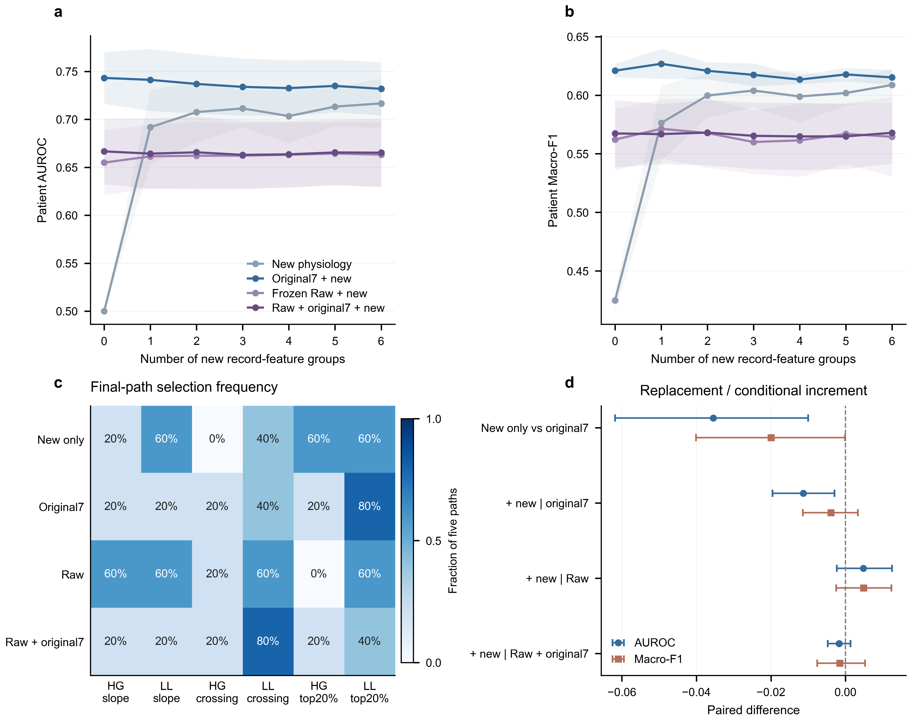

# Conditional contribution of six record-level physiological features

## Result

The six qualified temporal descriptors carry predictive information on their
own, but this bounded experiment does not identify a stable replacement for
the original seven physiological attributes or a reliable increment over Raw
context. Adding the selected descriptors to Raw plus original7 reduced the
four-endpoint utility by0.005209, with exploratory95% paired interval
[−0.010099,−0.000054]. The registered continuation rule failed. No additional
encoder, full M8 or Outer run was launched.

This follows the [source audit](../m8_nonlocal8_eligibility_audit_seed42_v1/AUDIT_REPORT.md)
and [measurement qualification](../m8_nonlocal6_measurement_qualification_seed42_v1/REPORT.md).
The six groups are early partial-high-gamma and line-length slopes, their
baseline-crossing descriptors, and their post top20% descriptors. Slopes and
top20% values each contribute seizure mean/SD; crossing groups contribute mean
observed crossing position and crossing proportion. High gamma remains the
retained80–125 Hz band. Crossing position is a feature-threshold event, not
clinical onset time. The two order-dependent historical ranks remain excluded.

## Matched design

All20 original inner selection partitions were reused, inside each original
fold's FIT. Selection TRAIN fitted the heads; CAL selected thresholds; CHOICE
selected the subset. Each of15 assessment paths retained separate HELD
patients. The five final paths have no HELD and supply fold-specific selection
and stability, not additional performance estimates. The assessed data contain
255 patient-fold appearances and79 distinct patients under these original
roles. The measurement cohort remains80 patients; no patient was removed
because of a feature value or result.

Four contexts were fixed before fitting: no baseline coordinates, original7,
frozen Raw192, and frozen Raw192 plus original7. Each considered all64 subsets
of the six new groups, including the empty set. Raw192 concatenates the two
previously specified latent time supports from20 genuinely inner-cross-fitted
encoders. It is unchanged across matched comparisons. Original7 supplies14
mean/SD coordinates, while each new group supplies two coordinates. Thus k
here counts new measurement groups, not scalar dimensions or total physiology
attributes in the old7 contexts.

Both old and new physiological coordinates received the same float64,
exact-constant-safe patient-relative transform. Mean imputation and
standardization used the corresponding TRAIN only; assessed heads refitted
these operations on TRAIN+CHOICE. No imputation/scaler used CAL or HELD labels
or values to estimate its fitted statistics. Whole-patient relative transforms
use that patient's unlabeled channels, as in the existing protocol. Eligibility
was recomputed only within selection TRAIN and all six groups passed in all20
paths. Original feature arrays and previous trained models were not changed.

The low-cost head was full dense weighted ridge with alpha1 and a fitted
intercept. Patient-equal inverse-global-class weights, the2EZ−1 target and
sigmoid score link were fixed. CAL selected the original0–1 by0.005 threshold.
The CHOICE score averaged AUROC, AP, Macro-F1 and EZ-F1, with0.1 times the
sample source-utility SD subtracted. Selection chose the smallest k within
0.005 of the maximum score, then the best subset at that k. All80 choices were
frozen before HELD predictions; all60 assessment score cells were sealed
before the separate evaluator indexed HELD labels.

These are complete implementations of the registered ridge screen. They are
not renamed full M8 models or substituted full Raw neural baselines. The
previous end-to-end comparisons remain in the
[main research synthesis](../m8_physiology_goal_evidence_audit_seed42_v1/RESEARCH_SYNTHESIS.md).

## Patient-level results

Primary means are over the255 patient-fold appearances. Every row below uses
the same assessment patients. `+ selected new` denotes the subset chosen for
each path, not a single globally adopted set. The intercept-only PHYS baseline
is included in the source tables; its AUROC is0.5 and Macro-F1 is0.424926.

| Ridge input | AUROC | AP | Macro-F1 | EZ-F1 | NEZ-F1 | ACC | MRR | Top-1 |
| --- | ---: | ---: | ---: | ---: | ---: | ---: | ---: | ---: |
| Selected new only | 0.707716 | 0.504456 | 0.600930 | 0.415918 | 0.785942 | 0.707471 | 0.719086 | 0.619608 |
| Original7 | 0.743206 | 0.541932 | 0.620935 | 0.429546 | 0.812324 | 0.736258 | 0.723138 | 0.603922 |
| Original7 + selected new | 0.731852 | 0.534535 | 0.616991 | 0.429302 | 0.804679 | 0.726995 | 0.723922 | 0.600000 |
| Frozen Raw | 0.654907 | 0.444856 | 0.562096 | 0.324091 | 0.800102 | 0.710245 | 0.651411 | 0.517647 |
| Frozen Raw + selected new | 0.659686 | 0.447282 | 0.566931 | 0.328099 | 0.805762 | 0.716163 | 0.643513 | 0.505882 |
| Frozen Raw + original7 | 0.666628 | 0.462119 | 0.567346 | 0.339850 | 0.794843 | 0.705055 | 0.697768 | 0.560784 |
| Frozen Raw + original7 + selected new | 0.664914 | 0.456884 | 0.565775 | 0.327534 | 0.804015 | 0.715765 | 0.691165 | 0.545098 |

All nine endpoints, including EZ-fraction bias, are reported for every logical
arm and k in `results/MAIN_RESULTS.csv`, with fold/source and unique-identity
equal summaries. The lower absolute Raw ridge scores must not be read as
performance estimates of the original nonlinear Raw-only model.

### Replacement and Raw increment

Selected new-only versus original7 changed AUROC by−0.035490
[−0.061826,−0.010037], AP by−0.037475[−0.073669,−0.004357],
and Macro-F1 by−0.020005[−0.040110,−0.000105]. The separate six-endpoint
max-standardized bootstrap sensitivity retained a negative AUROC interval
[−0.068096,−0.002884]; its AP and Macro-F1 intervals included zero. This
does not support replacement by this selected six-family dictionary.

Adding selected new groups to frozen Raw changed AUROC by0.004779
[−0.002351,0.012482], AP by0.002426[−0.007377,0.012119], Macro-F1
by0.004834[−0.002516,0.012327], and EZ-F1 by0.004008
[−0.008956,0.017207]. MRR and Top-1 point estimates decreased. The clinical
point estimates alone do not establish a general Raw increment.

With original7 already present alongside Raw, selected-new AUROC changed
by−0.001714[−0.004773,0.001353], AP by−0.005235
[−0.009781,−0.000902], and EZ-F1 by−0.012316
[−0.023152,−0.000552]. ACC increased by0.010710 and NEZ-F1 by0.009173,
while predicted EZ fraction relative to the same labels decreased by0.023313.
The accuracy increase therefore accompanies an EZ/NEZ tradeoff, not a uniform
localization improvement. Multiplicity sensitivities and all endpoints remain
visible rather than selecting only favorable ACC or unfavorable F1 values.

## Equal-k replacement and stability

Each path also evaluated its best CHOICE-selected alternative at the selected
k and two seed-fixed random equal-k subsets. Duplicate masks were aliases,
not independent refits. All contrasts are paired on identical patients.

| Context | AUROC selected − best alternative | AUROC selected − random A | AUROC selected − random B |
| --- | --- | --- | --- |
| New only | 0.021166 [0.007570,0.034886] | 0.007101 [−0.007605,0.021998] | 0.020343 [0.000983,0.039267] |
| Original7 + new | 0.000843 [−0.005247,0.006661] | −0.000753 [−0.008265,0.007017] | −0.002860 [−0.009331,0.003643] |
| Raw + new | 0.003491 [−0.000876,0.007850] | 0.003389 [−0.000337,0.007243] | 0.002682 [−0.001240,0.006898] |
| Raw + original7 + new | 0.000275 [−0.003405,0.004231] | −0.002432 [−0.005182,0.000359] | −0.001810 [−0.003930,0.000398] |

Without a baseline, some selected new combinations rank better than other
equal-k combinations, although not better than both random draws. Conditional
on original physiology or Raw, the intervals above do not distinguish the
selected combination from these alternatives. This is insufficient evidence
of hard-to-replace conditional value.

| Context | Final k across five paths | Mean final-set Jaccard | Mean assessment-set Jaccard |
| --- | --- | ---: | ---: |
| New only | 1,3,3,3,2 | 0.261667 | 0.381270 |
| Original7 + new | 3,2,1,2,2 | 0.250000 | 0.213492 |
| Raw + new | 2,3,3,4,1 | 0.293333 | 0.231429 |
| Raw + original7 + new | 1,2,3,2,2 | 0.241667 | 0.157937 |

The LL crossing group appears in4/5 final Raw+original7 paths, but every other
group appears in at most2/5 there. A frequent individual attribute is not a
stable joint optimum. These Jaccards describe overlapping FITs, not independent
replication. Cardinality curves show all k, but were not used to revise the
selection rule after HELD outcomes.

## Sources, uncertainty and decision

Raw+original7 selected-minus-baseline source AUROC changes were−0.001753 in
HUP,−0.000582 in LZU,0.000843 in the multicenter stratum and−0.011715 in
the pediatric stratum. The predeclared−0.02 source-loss tolerance passed,
but clinical mean directions, utility interval and final-set Jaccard criteria
failed. The gate was not relaxed. These are known-source strata under the
original patient-held-out roles, not leave-one-source-out validation.

Intervals use10000 seed42 paired patient-ID cluster draws, retaining repeated
appearances together. They condition on fitted heads and the observed
selection; they are not a full resampling of encoder/feature-search training.
Six-endpoint simultaneous sensitivities apply within each contrast, not across
all contexts, prior studies or the project. Internal cohorts and historical
Outer have been repeatedly viewed, so these intervals are exploratory rather
than independent confirmation. Unique-identity-equal results retain the same
qualitative direction for the main comparisons.

The supported decision is not to expand this six-group screen into further
neural or Outer training. Their computational source is now established;
their exclusion from the next model is an outcome of this matched predictive
screen, not a claim that unreliable data prove biological ineffectiveness.
Finite small CHOICE sets, the ridge model family and the retained-band cache
scope limit interpretation. A nonlinear conditional effect outside this
registration remains untested, not disproven. No universal minimal4D/5D/7D
set or new clinical SOZ gain is adopted from these results.

## Execution and reproducibility

Protocol and frozen scientific source were published at `783f631` before
fitting. All5,120 search fits and574 distinct assessment refits completed;
the independent verifier replayed every fit and all80 choices. Maximum
choice-score and assessment-probability replay errors were0. All13,260 logical
patient metric rows were checked by sklearn classification metrics plus
explicit ranking and the pinned original metric implementation. Aliased arms
are not counted as new models. No new encoder, extraction or Outer inference
was performed. Previous released results, checkpoints and prediction seals
remain unchanged.

Server order is `prepare_inputs.py`, `select_and_seal.py select`,
`select_and_seal.py seal`, `evaluate_sealed.py`, `verify_experiment.py`, then
`export_public.py`. `run_stages.py` preserves native logs and owns foreground
execution. `verify_release.py` checks public bytes and reported values locally.
Only anonymous aggregate tables, source and figures are published.

## Figure

**Figure1. Temporal record features in matched low-cost contexts.** Panels a/b
show patient AUROC/Macro-F1 at every new-group cardinality. Lines use255
patient-fold appearances from79 identities; shading is sample SD across five
original FIT folds, not a CI. At each k, CHOICE selected the subset and HELD
assessed it. Panel c shows selection frequency over the five final paths.
Panel d compares new-only physiology with original7 and each incremental
context with its no-new-feature baseline; bars are unadjusted95% paired
patient-ID cluster percentile intervals. No p-values are displayed. All
contexts and cardinalities are exploratory, with repeated internal data.
SVG/PDF,600dpi PNG/TIFF and three anonymous source tables accompany the figure.
