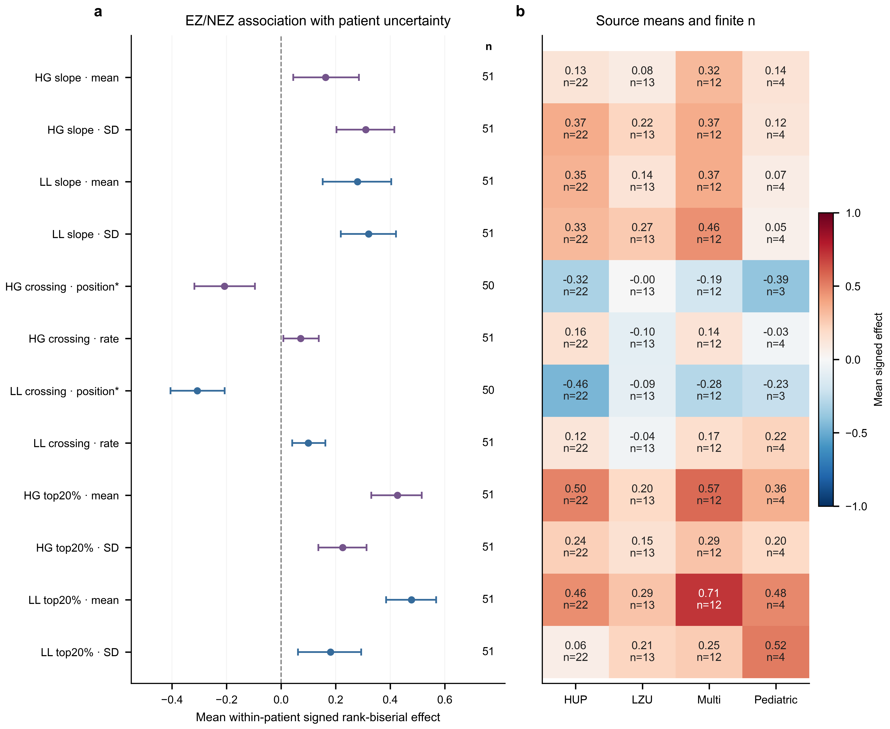

# Physiological association versus conditional prediction

## Main finding

Qualified record descriptors show EZ/NEZ associations even though the preceding
matched predictive experiment did not establish incremental localization
value. Of12 new coordinates,10 satisfy the fixed association-support rule.
Only3 of the8 coordinates with a per-seizure analogue satisfy the additional
directed repetition rule. Their data source is computationally supported;
neither their biological irrelevance nor their predictive necessity follows
from the failed classifier continuation gate.

The atlas also independently reaggregates all800 original fold-feature-phase
estimates and3200 source summaries from their fixed private patient effects.
All original p-values, confidence intervals, per-fold BH values and operational
flags reproduce to within1.110223e-16. Original files remain unchanged. This is
an independent statistical check of stored effect rows, not a second extraction
or independent waveform measurement.

## Design and statistical unit

The primary cohort is the same original fold1 FIT51 patients. No Development
or Outer labels were used. The other four historical FIT cohorts overlap;
their sizes are51,50,52,51, not four extra independent replications. The full
measurement registry remains80 patients,7,635 channels and256 records. The
primary51 patients contribute162 records. A patient, not a channel, record or
window, is the inferential replicate.

For each coordinate and patient, the signed rank-biserial effect compares EZ
and NEZ channels using finite values:2U/(nEZ nNEZ)−1. Positive values indicate
larger measurements in EZ. Both classes must be present. Missing observed
crossing positions are not assigned zero or a late fallback. Two crossing
position endpoints have50 finite patient contrasts; other endpoints have51.
Every patient remains in the cohort and in all available endpoint analyses.

Reported effects are means across patients with10000 seed42 patient-bootstrap
percentile95% intervals. The paired signed-rank convention from the original
study is retained: two-sided Wilcoxon, zero_method=wilcox, method=auto;
all-zero effect vectors receive p1. The12 new endpoints have one BH family.
An additional exploratory172-test atlas combines all160 old primary p-values
with these12, without changing the original160-test results. Bootstrap
intervals target the mean; signed-rank p-values concern a signed-location
comparison under its assumptions and need not agree with a mean interval.

Association support additionally requires at least60% of patient effects in
the mean direction, and matching mean direction in at least three source
strata with at least five finite patients each. It is a descriptive operational
rule, not a classifier-selection rule. No endpoint was chosen after inspecting
these new associations. Prior predictions and original160 associations were
already known, so the extension is exploratory, not independent confirmation.

## All12 new coordinate results

HG denotes partial80–125 Hz high gamma. Position is the normalized
baseline-threshold crossing position conditional on an observed eligible
crossing, not clinical seizure onset. SD is across available seizures.

| Coordinate | n | Mean effect | 95% patient interval | BH q within12 | Association support |
| --- | ---: | ---: | --- | ---: | --- |
| HG slope mean | 51 | 0.162656 | [0.044004,0.285238] | 0.0193273 | Yes |
| HG slope SD | 51 | 0.309835 | [0.203163,0.414634] | 0.0000126381 | Yes |
| LL slope mean | 51 | 0.279774 | [0.152118,0.403267] | 0.000619903 | Yes |
| LL slope SD | 51 | 0.320917 | [0.218695,0.420892] | 0.00000751383 | Yes |
| HG crossing position | 50 | −0.207802 | [−0.318329,−0.095755] | 0.00257315 | Yes |
| HG crossing rate | 51 | 0.071267 | [0.008159,0.137957] | 0.0696547 | No |
| LL crossing position | 50 | −0.307433 | [−0.405707,−0.207127] | 0.00000636028 | Yes |
| LL crossing rate | 51 | 0.099713 | [0.040869,0.161763] | 0.00259767 | No |
| HG top20% mean | 51 | 0.426130 | [0.330188,0.515647] | 0.000000163294 | Yes |
| HG top20% SD | 51 | 0.225198 | [0.136463,0.313263] | 0.0000714825 | Yes |
| LL top20% mean | 51 | 0.477551 | [0.384711,0.568515] | 0.0000000830658 | Yes |
| LL top20% SD | 51 | 0.180866 | [0.061843,0.293331] | 0.00522458 | Yes |

The rate endpoints illustrate why a positive mean alone is insufficient.
HG rate has a positive mean-bootstrap interval but signed-rank p/BH q0.069655;
it does not pass the specified rule. LL rate passes the q criterion, but only
58.8% of patient effects share the mean direction and only two eligible
source strata share that direction. It also does not pass. Neither result was
reclassified by selecting the favorable inferential convention.

Across-seizure SD associations describe heterogeneity in the pooled measured
seizures. They do not establish within-seizure reproducibility or independence
from episode coverage. The four SD coordinates have no single-seizure analogue
and their record-repetition criterion is not applicable.

## Repeated-seizure and source evidence

Directed agreement counts every finite per-seizure effect, including zero as
not agreeing, against the aggregate mean direction. Patients need at least
two finite seizure effects. The added repetition rule requires at least10
such patients and median agreement at least0.7.

| Coordinate | Repeated patients | Finite record effects | Zero record effects | Median directed agreement | Repetition support |
| --- | ---: | ---: | ---: | ---: | --- |
| HG slope mean | 48 | 162 | 0 | 0.666667 | No |
| LL slope mean | 48 | 162 | 1 | 0.750000 | Yes |
| HG crossing position | 47 | 157 | 4 | 0.666667 | No |
| HG crossing rate | 48 | 162 | 65 | 0.333333 | No |
| LL crossing position | 46 | 156 | 5 | 0.666667 | No |
| LL crossing rate | 48 | 162 | 64 | 0.333333 | No |
| HG top20% mean | 48 | 162 | 0 | 1.000000 | Yes |
| LL top20% mean | 48 | 162 | 0 | 1.000000 | Yes |

The earlier direction-agnostic, nonzero-only majority statistic answers a
different question. For HG crossing rate it is1.000 over29 patients, whereas
the directed, zero-inclusive statistic is0.333 over48 patients. The changed
estimand and denominator both matter; these are not two estimates of an
identical quantity. Both are reported. No old operational flag or model was
changed using this comparison.

The primary cohort contains22 HUP,13 LZU,12 multicenter and4 pediatric
patients. Pediatric crossing-position contrasts have only3 finite patients.
Thus only the first three source strata meet the prespecified minimum-five
criterion. For example, LL top20% mean effects are0.462053,0.286217,0.711025
and0.484196, respectively. The pediatric95% interval is[−0.074337,0.821747].
Shared point-estimate direction is not precise pediatric replication, and a
significant effect in one source versus an imprecise effect in another is not
itself evidence of an interaction. These are source-stratified associations,
not unseen-center validation.

## Why consider or exclude each attribute?

`FEATURE38_EVIDENCE_LEDGER.csv` connects the32 window-based groups with these
six record groups. It gives their definitions, measurement rationale, source
status, association evidence, actual internal selection counts and limits on
conditional interpretation. The source records are versioned public outputs,
not a new ranking based on Outer results.

- Spectral power, amplitude, roughness, complexity and network attributes were
  considered as different measurable aspects of recruitment. Numerical
  log/floor variants remain separate operators; they are not automatically
  independent physiological attributes. The ledger includes all32, not only
  previously selected groups.
- The six record groups add recruitment trend, threshold-event timing/rate and
  post-event concentration. Their source/mask and censoring definitions were
  qualified before the bounded predictive screen. Positive associations now
  explain why they were plausible candidates, not why they must be adopted.
- Historical delta/theta fields are zero in all1,471,965 valid cached windows
  and lack a passed LF fidelity gate. Their exclusion is missing trustworthy
  measurement, not evidence against low-frequency physiology.
- Seven source-mismatched cached graph operators were not reused unchanged;
  seven verified Raw-rebuilt counterparts were tested. The two tied-latency
  ranks remain excluded because their values depend on channel order.
- Partial alpha remains10–13 Hz and HG remains80–125 Hz. Full alpha, LF,
  full80–150 Hz HG and acquisition-filter ground truth were not recovered by
  relabeling these quantities.

`HISTORICAL28_CURRENT_RESOLUTION.csv` accounts for all28 legacy definitions:
11 retained-band window counterparts,7 distinct verified graph counterparts,
6 distinct qualified record operators,2 unavailable LF fields and2 excluded
rank operators. Source-equivalence claims are kept separate from attribute
availability. High correlation in the label-blind window summaries is recorded
without declaring zero conditional value or automatically deleting a group.

The38 groups would have76 mean/SD-or-crossing coordinates if concatenated.
No joint38-group/76-coordinate model has been trained. They were examined in
the explicitly separate32-group and6-group studies; combining their selection
frequencies cannot establish a jointly optimal set.

## Relation to localization performance and the final feature decision

The [bounded six-group predictive screen](../m8_nonlocal6_conditional_selection_seed42_v1/REPORT.md)
selected a new-only procedure with patient AUROC0.707716 compared with0.743206
for matched original7. With Raw+original7 already present, adding selected new
groups changed four-endpoint utility by−0.005209
[−0.010099,−0.000054] and yielded final-set Jaccard0.241667. Its allocation
gate failed and remains failed. These are previously sealed internal ridge
results, not new classifier metrics generated by this atlas.

The coexistence of associations and failed conditional improvement is the
supported finding. A repeated physiological attribute may encode information
already represented by other features, or its chosen summary/head may fail to
make that information useful. This study does not distinguish those mechanisms
causally and does not declare the attribute intrinsically useless.

No new final feature set is adopted. Original7 remains a reproducible
comparator, not a proven global optimum. The broader
[research synthesis](../m8_physiology_goal_evidence_audit_seed42_v1/RESEARCH_SYNTHESIS.md)
retains the actual full D1, Concat, Raw and M8 comparisons and their negative
or inconclusive increments. Association flags in this atlas do not reopen
either failed predictive continuation rule or authorize another Outer search.
Stable minimality, independent clinical SOZ validity and a reliable Raw/M8
increment remain unestablished.
The predictive screen selected two-coordinate groups; a group's selection
frequency cannot identify whether its observed-position, rate, mean or SD
coordinate supplied conditional value.

## Verification, reproduction and chronology

The protocol was published at `2ddb372` before the new associations. The first
audit used an incorrect equal51-per-fold admission assertion. Original private
groups and split metadata instead agree on51,51,50,52,51. The guard-only
amendment at `f3a6007` replaces exactly that assertion; statistical operations
and original source remain unchanged. The failed source/log/freeze are kept,
and accepted results use a separate namespace. No patient was added or removed.

Independent verification checked612 new patient effects and1296 per-record
effects using ROC concordance against the Mann–Whitney U implementation.
Maximum effect difference was2.220446e-16. SciPy's independent BH implementation
checked both new12 and combined172 families; source intervals, counts and
recurrence rules also reproduced. The old audit checked10,400 numeric/flag
cells in800 rows plus3200 source rows. Original primary109/160 operational
support flags are unchanged; these correlated phase/operator tests are not
109 independent useful features.

Actual CPU environment: Python3.10.20, NumPy2.2.6, pandas2.3.3, SciPy1.15.3,
scikit-learn1.7.2, PyTorch2.8.0+cu128; numerical library threads1. No GPU
training or inference was run. Trusted data reproduction uses
`python run_atlas.py`, followed by `python verify_atlas.py` and
`python export_public.py`. A completed runtime is verified rather than
reanalysed; partial state requires an engineering review before restart.
The original `atlas.py` preserves the failed admission assumption and is not
the accepted entry. Public-only reproduction uses
`build_evidence_ledger.py`, `figures.py`, then `verify_release.py`. No raw EEG,
IDs, labels, individual effects, models or runtime logs are published.
Re-rendering resets manual figure review to PENDING; inspect the new exports
and record the review before the final release check.
Byte-bound sources must preserve their recorded line endings, for example
with Git `core.autocrlf=false`; do not bypass source checks after conversion.

## Figure

**Figure1. Qualified record-coordinate associations and source support.**
Panel a shows all12 within-patient EZ/NEZ rank-biserial effects averaged over
finite patients in the original fold1 FIT; bars are unadjusted95% intervals
from10000 patient resamples. n is50 or51 patients, not channel/window counts.
Panel b shows all48 source means with finite n in each cell, without clustering
or source-specific normalization. No weak or small-source row is removed.
Positive signed effects indicate larger feature values in EZ. Asterisked
positions condition on an observed eligible threshold crossing and are not
clinical onset estimates. P-values use the stated Wilcoxon/BH conventions and
are provided in source tables; no significance stars are plotted. All results
are exploratory. Editable SVG/PDF and600dpi PNG/TIFF are supplied.
