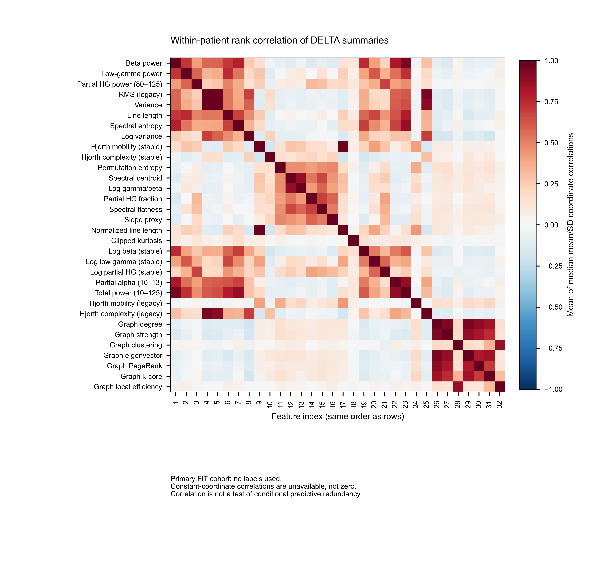
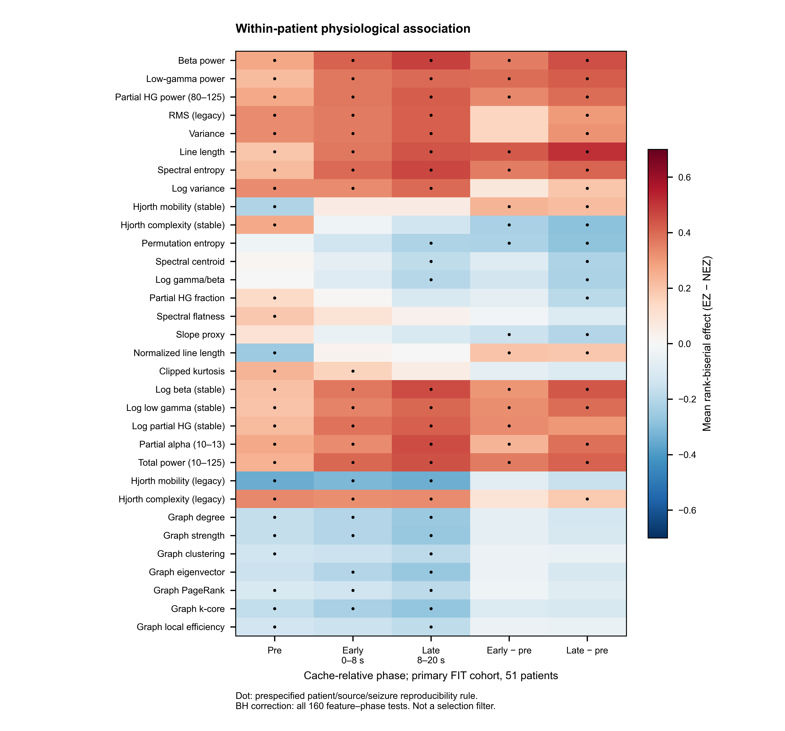
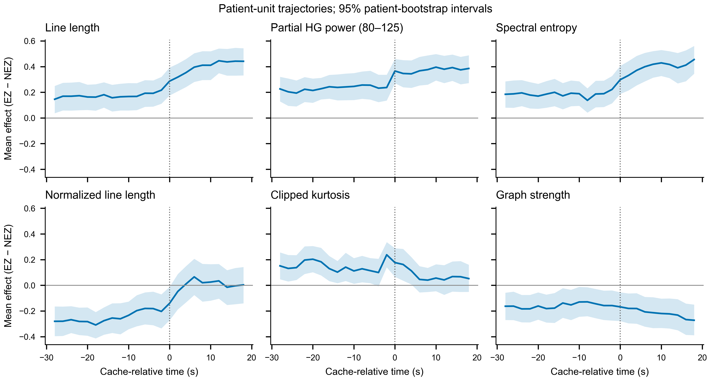
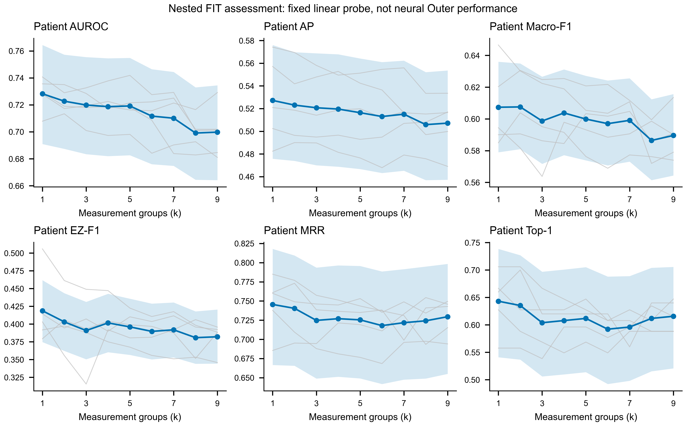
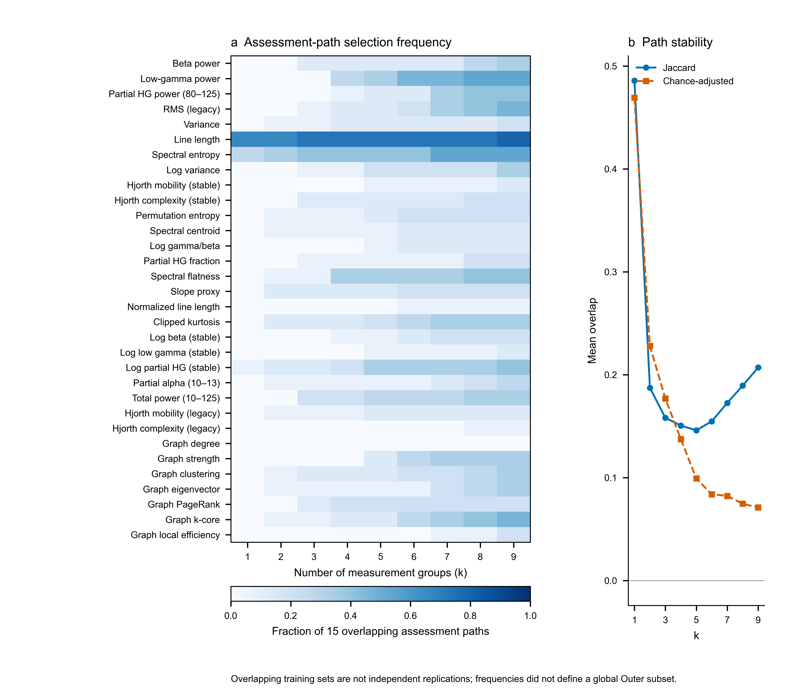
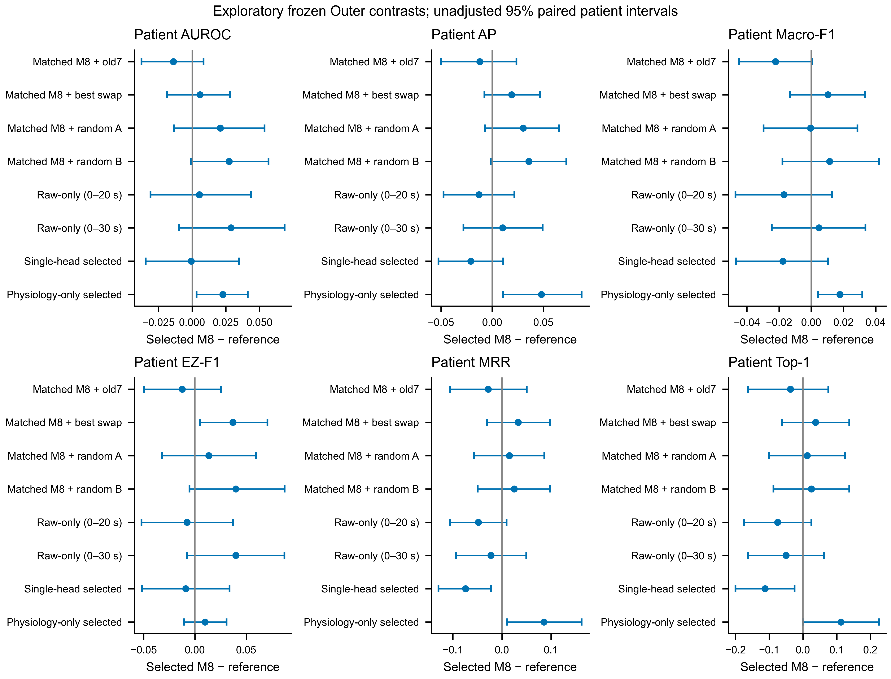

# Physiological Feature Discovery and Selection for DREChannNet

Research report for an IEEE JBHI-oriented manuscript. Completed16 October2026;
seed42; original patient-held-out fivefold protocol. This is an exploratory
study on a repeatedly examined cohort, not an independent clinical validation.

## Abstract

Physiological association, predictive sufficiency and complementarity to a Raw
encoder are different questions. We examined32 operationally admitted
measurements spanning spectral amplitude, morphology, complexity and graph
topology, while auditing all28 historical window-feature definitions. A nested
patient-isolated linear screen studied cardinalities1–9 and selected one or two
measurement groups in each fold. We then trained85 matched neural models,
including feature-only, single-head concatenation, M8 residual fusion and two
Raw-only temporal-support controls. Patient-unit effects identified repeatable
annotation-associated changes, especially in line length and band power. Those
associations did not establish an optimal feature set. The selected M8 reached
patient AUROC0.746607 and Macro-F1 0.613517, compared with0.760509 and0.635720 for
the same-width original-seven reference. Selected concatenation showed a small
ranking increment over its matched Raw-only model, without an established
Macro-F1 or EZ-F1 increment. The results reject automatic transfer of linear
screening sparsity to the M8 feature set and distinguish measurement
unavailability from physiological ineffectiveness.

## Why these physiological properties were considered

We separate four kinds of information. Amplitude and retained-band power
describe recruitment magnitude; line length combines magnitude and temporal
roughness. Spectral distribution and ordinal/Hjorth measurements describe
different aspects of signal organization. Graph-node measurements describe a
channel relative to the simultaneously observed network. These are candidate
descriptions of annotated channel differences, not interchangeable direct
measurements of epileptogenic tissue.

Primary studies motivate these distinctions rather than guarantee performance.
Ictal phase-locked high-gamma recruitment has been linked to surgical
localization, but its low-frequency phase and wider-band requirements are not
met by this cache; our80–125 Hz power is not PLHG.
[Weiss2015](https://pubmed.ncbi.nlm.nih.gov/25972493/)
Peri-ictal permutation entropy motivates an ordinal-complexity candidate, but
the published postictal/ictal index cannot be reproduced in this peri-onset
window. [Bratu2024](https://pubmed.ncbi.nlm.nih.gov/38041564/)
Spectral decomposition motivates testing shape beyond power, but our
restricted-bin slope proxy is not a periodic/aperiodic decomposition or an
excitation/inhibition estimate.
[Kozma2024](https://pubmed.ncbi.nlm.nih.gov/38795977/)

The project history makes a fixed-seven defense untenable. The earlier
[feature-discovery study](../m8_physiology_feature_discovery_seed42_v1/REPORT.md)
ran222 neural fits without a stable universal replacement. The
[joint variance/high-gamma/entropy study](../m8_joint_physiology_ablation_seed42_v1/REPORT.md)
showed nonadditive deletion responses but found no internally qualified4D/5D
replacement. The [single-head study](../m8_single_head_concat_seed42_v1/REPORT.md)
improved some first-hit rankings without uniformly improving classification.
Earlier A0 magnitude/normalization experiments likewise showed that a branch
can be used by a network without outperforming a separately trained control.
These negative experiments motivate matched replacements and Raw controls,
not retrospective selection of their highest Outer scores.

## Data and feature eligibility

All80 patients,7635 canonical channels,256 seizures and1471965 valid250 Hz
channel-windows were retained. Each raw window has500 samples. The original
five folds and historical invalid-boundary masks were preserved. Label-blind
pool construction joined source/channel/time/mask identities and exactly
reproduced the original7-group summaries and previous14 candidate/numeric
DELTA arrays. This software/source equivalence is not an independent proof of
acquisition filtering, clinical seizure onset or surgical EZ truth.

The [measurement catalogue](FEATURE_CATALOGUE.md) defines every candidate and
distinguishes the following eligibility outcomes:

| Candidate family | Decision and evidence | What cannot be concluded |
|---|---|---|
| Historical delta/theta | Both zero in all1471965 valid windows; inherited LF fidelity gate failed | Low-frequency physiology is useless |
| Historical alpha/high gamma | Explicitly limited to10–13 and80–125 Hz | Complete alpha or full80–150 Hz/HFO was tested |
| Legacy cached graph | Inherited adjacency-source mismatch; not used as if equivalent | Network physiology is uninformative |
| Verified Raw-rebuilt graph7 | Exact signal/time/channel/mask admission; included | Graphs generalize beyond this operational source |
| Eight onset/burst descriptors | Broadcast constants within all24995 record/channel units; event/mask replay unproven | A window-DELTA subtraction is a fair negative test of event information |
| All32 prospective measurements | All finite-window fractions1.0; all640 own-subFIT gates passed | Finite means biologically valid or predictively indispensable |

No patient or window was selected for favorable feature quality. All new
groups passed; none was removed by a favorable Outer association. The
historical88D export's16 zero and16 duplicate coordinates are not32 different
physiological failures. The25 spectral/morphological measurements were computed
on the same valid Raw bank; seven existing independently source-checked rebuilt
graph fields were joined rather than silently substituting the old graphs.

Numerical representation matters. In the primary FIT sample,98.04% of patient
partial-HG summary mean/SD coordinates had pre-normalization channel SD below
1e-8; beta's corresponding fractions were86.27%/94.12%. These are diagnostics
of the historical scale/floor geometry, not justification to change epsilon
or claim that log transformation recovered signal. Stable-log candidates are
distinct numeric controls. The label-blind correlation map shows power,
amplitude and graph clusters; correlation alone did not exclude a group.

## Patient-unit physiological evidence

The primary descriptive sample is the51 unique patients in fold1 FIT.
Other-fold FIT analyses overlap and are sensitivity analyses, not independent
replications. For each patient, available seizures were averaged within pre,
early0–8 s and late8–20 s phases; post-minus-pre channel contrasts were also
formed. Signed rank-biserial effects compare EZ with NEZ channels within that
patient. Positive means higher values in annotated EZ, not greater clinical
epileptogenicity. Patients, not windows/channels, are the uncertainty unit.

We fixed a160-test family (32 measurements×5 phases), Wilcoxon tests with BH
correction,10000 patient bootstrap intervals and an operational reproducibility
rule before running this analysis. The rule requires corrected q<.05, an
interval excluding zero, at least60% patient direction agreement, at least
three eligible source groups with matching direction, and repeated-seizure
agreement among patients with at least two finite nonzero seizure effects.
Zero-effect counts are separately retained. The rule was never used as a
supervised feature-selection filter.

| Late-minus-pre effect | Mean | 95% patient interval | BH q | Operational rule |
|---|---:|---|---:|---|
| Line length | +0.513447 | [0.419240,0.608589] | 5.96e-7 | Pass |
| Beta power | +0.449710 | [0.340299,0.552808] | 2.50e-6 | Pass |
| Partial high gamma | +0.391645 | [0.273363,0.508028] | 5.46e-6 | Pass |
| Spectral entropy | +0.406751 | [0.288153,0.518694] | 4.63e-6 | Pass |
| Variance | +0.313295 | [0.185544,0.437645] | 1.83e-4 | Pass |
| Partial alpha10–13 | +0.387012 | [0.272622,0.500604] | 4.63e-6 | Pass |
| Stable Hjorth complexity | −0.286010 | [−0.417453,−0.147348] | 8.55e-4 | Pass |
| Permutation entropy | −0.281550 | [−0.405370,−0.153754] | 3.75e-4 | Pass |
| Rebuilt graph strength | −0.111855 | [−0.222965,−0.002543] | 0.092379 | Fail |

Line-length late-minus-pre effects have90.20% patient direction agreement and
median repeated-seizure sign agreement1.0; all three source groups eligible
under the minimum-five-patient rule have matching direction. The graph-strength
contrast illustrates why an unadjusted interval excluding zero is not enough:
it fails the corrected family criterion. The full160 primary effects, all
five overlapping FIT sensitivity sets and source/seizure summaries are
published, not just the favorable rows above.

The measurements capture annotation-associated peri-onset differences in this
filtered cache. They do not prove a causal EZ mechanism. Reproducibility within
repeated seizures is not replication in an unseen clinical source, and the
source groups include a multicenter aggregate rather than four independent
hospitals.

## Efficient feature cardinality and stability experiment

All screening occurred inside each original outer-fold FIT. Three patient
assessment groups were used. Within the remaining patients, a deterministic
60/20/20 split separated fitting, threshold calibration and feature choice.
The fixed LR probe used C1, patient-equal inverse-class weighting and
own-subFIT imputation/scaling. Greedy forward choice used the equal average
of AUROC, AP, Macro-F1 and EZ-F1 on feature-choice patients. Thresholds came
only from calibration patients. Each cardinality was then refitted without
the assessment patients and evaluated on its untouched assessment group.

The cardinality decision used own-FIT assessment utility minus0.1 source
utility sample SD, choosing the smallest k within0.005 of the maximum. A
final own-FIT60/20/20 path supplied that fold's subset. Original Development
was excluded from all feature choices and later used only for neural epoch
and threshold selection. No global list was selected from crossfold results.

Actual cost was5253 search fits plus135 assessment fits, not a large neural
search. All5253 were independently refitted and all135 assessment predictions
replayed. The nine cardinality curves contain255 patient appearances/79 unique
patients per k; overlaps were clustered by patient ID, not treated as255
independent patients. Diagnostic8/9-group cases were allowed; no final7D or6D
constraint was imposed.

| k | Assessment AUROC | Assessment Macro-F1 |
|---:|---:|---:|
|1|0.728241|0.607360|
|2|0.722730|0.607550|
|3|0.719878|0.598685|
|4|0.718693|0.603767|
|5|0.719177|0.599906|
|6|0.711661|0.597011|
|7|0.710102|0.599108|
|8|0.699103|0.586444|
|9|0.699775|0.589578|

These curves favor sparse **linear procedures** in this bounded search; they
do not prove that every additional measurement hurts a nonlinear model. Their
bootstrap intervals condition on already selected paths and do not retrain
the selector or account for all adaptive selection uncertainty.

| Fold | Selected group count | Frozen measurements |
|---:|---:|---|
|1|1|Line length|
|2|1|Line length|
|3|1|Stable-log beta|
|4|2|Line length + partial alpha10–13|
|5|2|Stable Hjorth complexity + stable-log beta|

One group means two mean/SD input coordinates. The finalfold selections are
five different training procedures, not one universal1D/2D biomarker. Among15
assessment paths at k1, line length was selected10 times, spectral entropy4
times and stable-log partial HG once. Mean Jaccard was0.485714 at k1,
0.172530 at k7; chance-adjusted overlap fell from0.469124 to0.082231. The
frequency plot supports a recurrent line-length component but low multi-feature
set stability. Consensus was not applied to Outer.

## Matched replacement and neural training

For each fold we froze the selected subset, the best equal-k single-group
replacement under the same legal choice data, and two fixed random equal-k
subsets. Random draws were not rerolled. Each was evaluated as D1-only,
single-head Concat and M8, with an original7-group reference in each family.
The five recipe sets therefore use75 fits; five Raw-only fits and five
support-matched Raw-only fits bring the total to85. Complete feature allocations
and all comparisons appear in [RESULT_TABLES.md](RESULT_TABLES.md).

All recipes use fixed global64-coordinate physiology slots and the same
paired initialization, preprocessing, optimization budgets and validation
rules. D1 is a6337-parameter native-LN64/96-width classifier. M8 freezes that
scratch-trained D1 and trains its bounded Raw correction and conditioning
gate (16618 total/10281 trainable parameters). Concat uses a96D Raw summary
and64D physiology input with one unbounded160→64→1 head (12529 parameters),
an identity gate and no D1 logit. Raw-only is the same Concat with all
physiological inputs zero. Physiological groups are masked both in the D1/
Concat summaries and in the M8 gate after common FIT preprocessing.

These wider native-LN models are not identical to the historical11018-parameter
M8. Same-width old7 controls are therefore the feature-selection comparison;
historical M8/D1/Raw/S4 are explicitly architecture-different references.
No old trained D1 logits initialize the new models. One seed is used, not a
multi-seed architecture comparison.

| Outer procedure | AUROC | AP | Macro-F1 | EZ-F1 | NEZ-F1 | ACC | MRR | Top-1 |
|---|---:|---:|---:|---:|---:|---:|---:|---:|
| Selected D1 |0.723879|0.489084|0.595765|0.409030|0.782499|0.700573|0.651022|0.512500|
| Matched old7 D1 |0.738135|0.524326|0.619432|0.425477|0.813387|0.738784|0.713672|0.612500|
| Selected M8 |0.746607|0.537095|0.613517|0.418792|0.808243|0.728988|0.736549|0.625000|
| Matched old7 M8 |0.760509|0.549236|0.635720|0.431321|0.840120|0.767867|0.764700|0.662500|
| Selected Concat |0.747303|0.557994|0.631122|0.427810|0.834433|0.758067|0.810521|0.737500|
| Matched old7 Concat |0.756411|0.574993|0.636987|0.436108|0.837865|0.762763|0.813762|0.725000|
| Raw-only0–20 |0.741296|0.550114|0.630493|0.426475|0.834511|0.757014|0.784454|0.700000|
| Raw-only0–30 |0.717742|0.527038|0.608706|0.378923|0.838488|0.758909|0.758779|0.675000|
| Historical original M8 |0.762397|0.554067|0.634097|0.434087|0.834107|0.760166|0.749310|0.637500|

Every Outer procedure covers80 unique patients exactly once. The table is
patient-equal, not a pooled-channel AUROC or equal-fold average. All21
procedures, all nine endpoint coverage denominators and confusion counts are
available, including every random and replacement result.

The selected D1 outperformed randomA/B in AUROC by0.102066/0.121464 with
unadjusted95% intervals[0.060929,0.145533]/[0.077764,0.166809]. Thus the
selected measurements were not arbitrary within the tested replacements.
However, selected D1 did not establish superiority to its best-swap competitor
in AUROC (delta0.022262, CI[−0.005311,0.050994]), and did not retain old7
classification/ranking performance. Two random controls and one single-swap
neighborhood cannot establish universal irreplaceability.

For selected M8 minus matched-old7, the paired changes were AUROC−0.013901
[−0.037671,0.008473], AP−0.012141[−0.049853,0.023699], Macro-F1−0.022203
[−0.044935,0.000307] and EZ-F1−0.012529[−0.049791,0.025603]. These do not
establish a gain or noninferiority; there was no prespecified clinical
noninferiority margin. ACC and NEZ-F1 declined even with the eight-endpoint
familywise interval. No favorable post-Outer subset was substituted.

## Raw complementarity and source stability

Selected Concat minus matched Raw-only0–20 improved AUROC by0.006007
[0.000192,0.011899] and AP by0.007880[0.001450,0.014513]. These are small,
unadjusted exploratory ranking increments, not proof that explicit physiology
is irrelevant. Macro-F1 changed by0.000628[−0.006834,0.008456] and EZ-F1 by
0.001335[−0.011014,0.014324]; thresholded localization benefit was not
established. Its MRR/Top-1 changes were0.026067/0.037500, with intervals spanning
zero. Selected M8 did not establish an increment over the same Raw-only
reference in any of the six primary metrics.

The physiological summary includes valid windows beyond20 s, whereas the
original Raw branch pools0–20 s. Before new Outer inference we registered
and trained a Raw-only control extending the late pool to8–30 s, with identical
initial states, scales, head capacity and seeds. This control was worse than
the original Raw-only on AUROC (0.717742 versus0.741296). Selected Concat
exceeded it by0.029561 AUROC and0.022416 Macro-F1. This does not license choosing
the weaker Raw baseline: both are reported. It shows that a longer late Raw
mean pool alone did not explain the observed Concat ranking increment under
these two fixed representations. It is not a proof against all possible Raw
encoders, pooling designs or equal-compute alternatives.

Raw can also compensate for weak physiological combinations. In D1 the
selected-minus-randomA AUROC advantage was0.102066; in M8 it was0.020852.
The fixed-score difference of these advantages was−0.081214
[−0.118237,−0.045323]; for randomB it was−0.094052
[−0.134355,−0.056526]. This **post hoc diagnostic** is consistent with Raw
attenuating the disadvantage of weak physiological inputs. It is not a causal
decomposition, because M8 changes the objective, gate, frozen base and trainable
path. A model that tolerates a feature deletion is not evidence that the
deleted feature itself contains no information.

Source patterns limit transport claims. Selected-minus-old7 M8 AUROC was
negative in all four source groups; Macro-F1 improved in LZU but declined in
HUP, multicenter and pediatric groups. Selected Concat's Raw-only AUROC
increments were positive in all four groups, but only LZU's unadjusted source
interval excluded zero; multicenter Macro-F1 declined0.021849
[−0.043042,−0.003528]. Source sizes were36,21,15 and8. These are held-patient
results within known source strata, not leave-source-out or external-center
validation. Full source-paired intervals are published without source-specific
threshold tuning.

Selected M8 AUROC fold SD was0.063422 versus0.042116 for matched-old7;
Macro-F1 SD was0.032418 versus0.047777. Stability depends on the endpoint;
neither selective reporting of lower F1 SD nor higher average AUROC is an
adequate stability claim.

## Statistical interpretation and decision

All85 new checkpoints, feature masks, scalers, epochs and validation-only
thresholds were frozen before new Outer inference. All105 score cells,
including20 reused historical references, were sealed before full-label
reporting. Patient metrics, aggregate tables and10000 common patient-bootstrap
draws were independently replayed. Development contains65 appearances/47
identities; nested FIT assessment contains255 appearances/79 identities per k.
ID-cluster resampling carries their repeated appearances together.

Intervals condition on frozen models. They do not include seed, re-training,
full selection or years of adaptive research uncertainty. The eight-endpoint
selected-M8 versus old7 family has separately reported Bonferroni intervals;
other replacement/source/compensation intervals are unadjusted. No correction
turns a repeatedly viewed Outer into an independent confirmation cohort.

Several cache-supported
physiological properties show reproducible within-patient annotated-channel
differences, but availability and association are not conditional predictive
necessity. The bounded linear selector identifies informative sparse
sets relative to tested random replacements, yet those sets do not transfer
as a stable substitute for old7 in the trained M8. Explicit physiology
provides a small exploratory ranking increment in the matched single-head
route, not a demonstrated broad SOZ localization improvement.

**No new universal feature set is adopted.** The old7 remains a reference, not
a proven minimal/optimal physiological basis. This experiment does not prove
that the best model is7D, nor that a1–3D model cannot work. Further narrowing
would require model-family-matched nested selection, predeclared performance/
cost tradeoffs and independent confirmation. More adaptive search against the
same Outer is not evidence for the best combination. This run stops rather
than performing an outcome-driven rescue.

The retained sparse measurements also show why feature discovery must track
representation. Stable-log beta and original beta describe the same retained
band through different numeric paths, yet Patient Z/flooring and nonlinear
normalization can give them different conditional utility. Their selection
cannot be presented as discovering a new physiological mechanism. Conversely,
the graph family's admission does not imply a selected graph is necessary.
The [project evidence map](PROJECT_EVIDENCE_MAP.md) connects these findings to
earlier cache audits, pruning, normalization, joint-deletion and fusion
experiments without converting historical Outer winners into new selections.

The labels are the project's EZ annotations. Independent clinical SOZ/onset
and surgical-outcome adjudication were not reconstructed in this study, so
the report does not claim improved clinical treatment or definitive SOZ truth.

## Deliverables

- [Complete result tables](RESULT_TABLES.md), [all measurement definitions and
  exclusions](FEATURE_CATALOGUE.md), [execution audit](ENGINEERING_AUDIT.md).
- `results/`: actual search records, eligibility gates, all physiological effects,
  cardinality/frequency/stability, all model/threshold selections, all21 Outer
  results, source/fold/paired uncertainty and independent verification.
- `figures/`: six editable SVG/PDF figures,600 dpi PNG/TIFF, anonymous source
  tables and visual QA. No synthetic points or unrun model rows.
- [README](README.md): server run sequence, fixed dependencies and privacy
  boundary. All code and anonymous results are uploaded to the study branch;
  raw, identifiers, per-patient/channel features/predictions, checkpoints,
  scalers and runtime logs remain on the trusted server.
