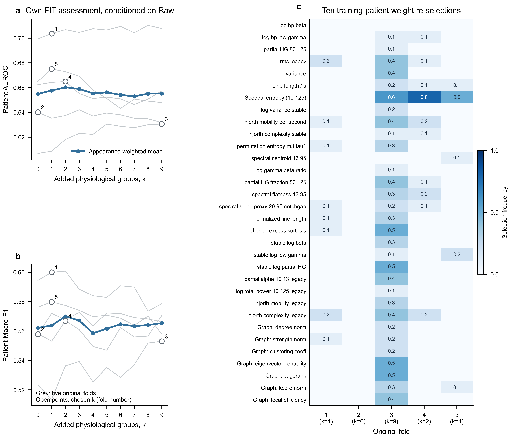
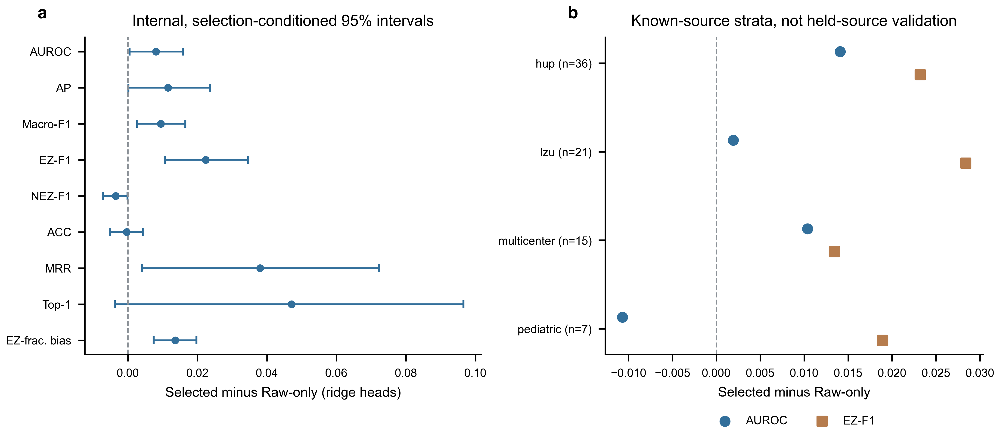

# Does physiology add information conditional on Raw?

Supplement to the completed DREChannNet feature-discovery study,16 October2026.
The [full physiological evidence and neural comparisons](../m8_physiology_discovery_selection_seed42_v2/REPORT.md)
remain unchanged. This experiment addresses a different question: which
physiological summaries retain predictive utility when feature choice already
conditions on patient-isolated Raw representations?

## Experimental design

Twenty Raw-only encoders were trained from scratch inside the original own-FIT
partitions. Selection-training and calibration patients determined their
weights, epochs and thresholds. Feature-choice and assessment labels were
absent from encoder training and checkpoint choice. Original Development and
Outer patients were excluded. All20 models completed286 epochs in total.

Each frozen encoder supplies two96D patient-relative summaries with0–20 s and
0–30 s late support. A weighted ridge head always retains both Raw summaries.
It adds0–9 physiological groups from the32 measurement pool, with two DELTA
mean/SD coordinates per group. Train-only imputation and scaling, alpha1,
patient-equal inverse-class weights and the sigmoid score mapping are fixed.
Calibration patients determine the classification threshold. Greedy feature
choice uses the mean of AUROC, AP, Macro-F1 and EZ-F1. After separate
assessment refits, each fold chooses the smallest k within0.005 of its maximum
utility minus0.1 times source-utility standard deviation. Zero additional
physiological groups is eligible.

The prospective protocol was published at40c56b4 before encoder fitting.
The numerical implementation amendment at62c0bce removed a failed block-solve
shortcut without changing the objective, inputs, scaling, partitions,
regularization, encoder or selection rules. The complete reference screen
contains9179 search-head fits and165 assessment-head fits. The30 final
feature-choice control rows use25 distinct additional ridge fits; duplicate
subsets are fitted once. Those controls are descriptive selected-choice
comparisons, not an independent assessment sample.

## Cardinality and feature identity

| Added groups k | Assessment AUROC | AP | Macro-F1 | EZ-F1 |
|---:|---:|---:|---:|---:|
|0|0.654907|0.444856|0.562096|0.324091|
|1|0.657582|0.452191|0.563795|0.319583|
|2|0.660197|0.456114|0.569910|0.333870|
|3|0.658895|0.455765|0.567121|0.327690|
|4|0.655306|0.452164|0.558490|0.315929|
|5|0.656078|0.452811|0.561600|0.322201|
|6|0.654115|0.451704|0.564538|0.323071|
|7|0.652884|0.450783|0.563228|0.325445|
|8|0.655061|0.452634|0.564041|0.339036|
|9|0.655160|0.453313|0.565314|0.339833|

Each row contains255 assessment appearances of79 distinct patients, not255
independent participants. These pooled means are descriptive and were not
used to impose one global k. The selected cardinalities are1,0,9,2,1.

| Fold | k | Selected physiological groups |
|---:|---:|---|
|1|1|Rebuilt local efficiency|
|2|0|None|
|3|9|Legacy RMS; variance; Hjorth mobility per second; partial-HG fraction80–125 Hz; clipped excess kurtosis; stable-log low gamma; rebuilt strength; eigenvector centrality; PageRank|
|4|2|Line length; legacy Hjorth mobility|
|5|1|Spectral entropy10–125 Hz|

The final fold sets have mean pairwise Jaccard0.0. That disagreement alone
cannot establish that their underlying physiological concepts are unrelated,
because correlated measurements and different training populations can be
substitutable. It does rule out describing the observed selection as one
shared stable set. Ten patient-weight re-selections per fold give mean
pairwise Jaccard0.0444,0.1829,0.2370 and0.2444 in the four nonzero-k folds.
The k0 fold has trivial empty-set agreement1.0. These perturbations keep
encoders and preprocessing fixed; they do not quantify full training or seed
uncertainty.

## Conditional internal performance

| Ridge procedure | AUROC | AP | Macro-F1 | EZ-F1 | NEZ-F1 | ACC | MRR | Top-1 |
|---|---:|---:|---:|---:|---:|---:|---:|---:|
|Raw-only192D|0.654907|0.444856|0.562096|0.324091|0.800102|0.710245|0.651411|0.517647|
|Raw + old7|0.654715|0.456413|0.549552|0.311063|0.788041|0.702785|0.679351|0.552941|
|Raw + own-FIT-selected groups|0.662999|0.456401|0.571542|0.346508|0.796577|0.709895|0.689470|0.564706|

The selected-minus-Raw-only changes are AUROC+0.008091
[0.000519,0.015791], AP+0.011545[0.000182,0.023611],
Macro-F1+0.009446[0.002684,0.016507], EZ-F1+0.022417
[0.010623,0.034634], MRR+0.038059[0.004150,0.072251] and
Top-1+0.047059[−0.003803,0.096525]. ACC changes by−0.000350
[−0.005159,0.004408] and NEZ-F1 by−0.003525
[−0.007199,−0.000090]. Signed EZ-fraction bias moves from−0.041953 to
−0.028340. These are10000-draw patient-ID cluster percentile intervals,
unadjusted across endpoints and conditional on the chosen paths/cardinality.

Cardinality selection reused these own-FIT assessment outcomes. Consequently
these intervals do not independently validate the complete selector, even
though no original Development or Outer outcome was used. Nor are ridge
readouts interchangeable with end-to-end M8 or Concat results. The correct
interpretation is a conditional internal signal accompanied by weak feature
identity stability, not a new clinical performance result.

All four known-source contrasts are reported. Selected-minus-Raw-only AUROC
is+0.014078 in HUP,+0.001929 in LZU,+0.010385 in multicenter and−0.010681
in pediatric data. EZ-F1 increases in all four strata. Pediatric support is
seven distinct patients. This is not held-source validation, and the source
pattern does not establish transportability.

## Consequences for feature discovery

Conditioning selection on Raw changes the selected measurements. The earlier
physiology-only screen repeatedly selected line length and stable-log beta;
the Raw-conditional sets are disjoint across final folds. A property can have
a repeatable EZ–NEZ association yet become redundant for a given Raw encoder.
Conversely, a low marginal rank need not imply no conditional utility. These
results support evaluating physiological association, measurement eligibility
and conditional prediction separately.

The experiment does not identify one stable minimum or establish that7D is
optimal. It also does not justify adopting the largest selected set, choosing
the pooled k2 peak, or calling the k0 fold proof that physiology is useless.
No further neural candidate or new Outer evaluation was selected from these
outcomes. Model-family-matched confirmation would need its own fixed inner
evaluation and a performance/cost criterion; a claim of independent clinical
improvement additionally needs independent data.

## Reproducibility and numerical record

All9179 search evaluations and165 assessment fits were replayed. Patient
metrics for2805 assessment rows were independently recomputed, including
thresholding and ranking. Partitions, imputation, scaling, greediness,
cardinality, best swaps and weight-bootstrap choices were checked. Maximum
choice-utility disagreement was5.55e-17.

The first block solver failed54 of720 absolute-score comparisons, with maximum
ridge-score error0.0006735. Some historically scaled physiological power
coordinates extrapolate to approximately10^10 on held inputs. Probability
differences were at most4.15e-13 and calibration decisions matched, but the
original score gate remains failed. No floor, clipping, feature rejection or
tolerance was changed. The full predeclared sklearn reference produced zero
score disagreement in its720 API-replay cases. That is canonical-API
conformance, not an independent numerical replication. A terminal nested-key
metadata exception was repaired after all heads completed, without repeating
their fits. Full source and execution details are in
[ENGINEERING_AUDIT.md](ENGINEERING_AUDIT.md).

The original study's models, thresholds, prediction seal and135 released
artifacts remain unchanged. Code, anonymous search records, all metrics,
selection allocations and figure source tables are public; representations,
patient identities, predictions, scalers, weights and logs remain private.
