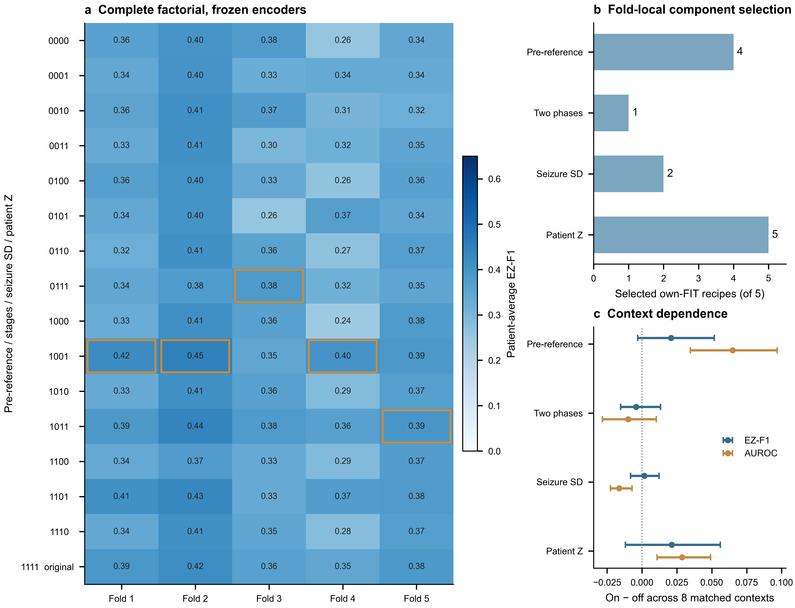
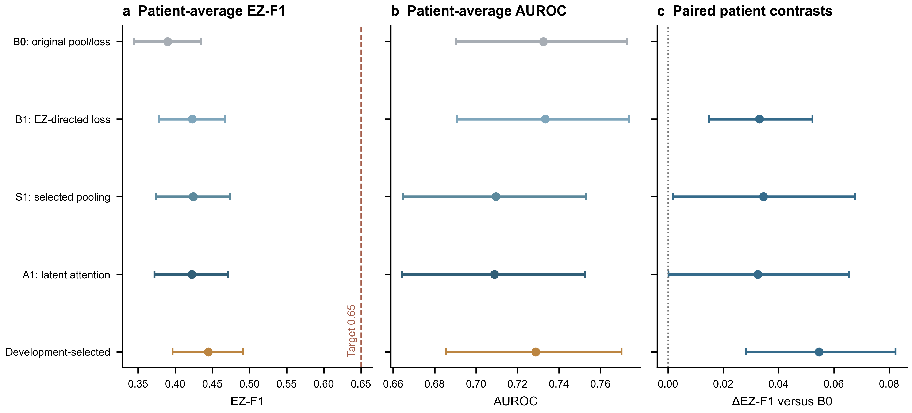

# 纯Raw潜变量组件与轻量优化：完整五折研究

## 1. 结果

预先定义的目标是**患者平均EZ阳性F1＞0.65**。Development选择策略的Outer EZ-F1为
**0.444341**，患者bootstrap的95%区间为**[0.396601, 0.490857]**，
本轮**未达到目标**。Macro-F1为0.616829，AUROC为0.728786，AP为0.540892。
这些指标不能互相替代，也没有按Outer挑选主模型。

本研究不使用人工生理特征或独立D1分支。模型输入仅为现有Raw250波形、原有效窗口掩码、
缓存相对时间和通道身份。历史Outer已多次被研究使用，因此本轮是**探索性重复测试**，不是新的独立确认。

## 2. 数据与模型

全部模型使用相同80位患者、7,635个通道、256次发作、1,471,965个原有效Raw窗口，
保留原五折patient-held-out划分。FIT患者数为51/51/50/52/51；Outer为16/16/17/15/16。
患者是统计单位，发作和窗口不被当作独立样本。跨来源结果是在来源混合训练下的患者留出，
不是leave-center-out试验。缓存相对发作时间沿用原数据，未新增临床时间标注验证或低频恢复。

共享CNN为两层1D卷积，通道宽度12/24，核9/7，步长4/4，GELU和全局平均池化。
每个有效2秒波形独立中心化、除以其population SD并截断到[-8,8]。
Raw24D按阶段、发作均值和SD形成96槽位，分类头为96→64→1无界NEZ logit。
预测EZ概率为sigmoid(-NEZ logit)。基础模型8,433参数，注意力模型8,851参数。
原160输入头的64个生理槽位为零；本轮纯96输入映射的历史表征误差0，logit最大误差2.3842e-7。
这个映射只验证数值接口，不是一次新的独立性能比较。

新模型均从头训练，配对共享Raw CNN与头初始化，不加载历史D1或训练后的Raw权重作初始化。
四个臂均采用AdamW(lr0.0003,wd0.001)、clip1、最多30轮、最少6轮、patience6，
每个完整FIT患者一次更新；FP32、TF32关闭。完整患者池化及Z的梯度传回CNN。

## 3. 四个组件的低成本筛选

完整2⁴矩阵检验同通道发作前latent扣除、0–8/8–20秒分阶段、可用发作population SD、
全患者latent Z。关闭分阶段时重复0–20秒汇总，关闭SD时置零SD槽位，保持同一96输入头接口。
槽位一致不代表有效信息维数一致。

复用20个真实inner-cross-fitted Raw编码器，原编码器仅见自己内层train/cal。
560次固定C1逻辑回归拟合和4,080个逻辑患者结果行完成。每个Outer FIT内独立使用
train/cal/choice/held角色，阈值只用cal，16组合选择只用该折FIT内结果；
原Development和该折Outer不参与此阶段。
255次患者-折出现来自79个唯一身份，重叠折不是独立重复。
所有16组合的assessment最高值参与选择，故筛选表不是无偏验证估计。
编码器原本按完整组件训练，因此该筛选也不能代替逐组件从头训练的因果消融。

| 折 | 参考/分阶段/发作SD/患者Z |
| --- | --- |
| 1 | 1001 |
| 2 | 1001 |
| 3 | 0111 |
| 4 | 1001 |
| 5 | 1011 |

五折选中次数：发作前参考4/5、分阶段1/5、
发作SD2/5、患者Z5/5。
这里的频率是算法在重叠FIT数据上的描述，不是统计显著性或通用必要性证明。

下表为打开组件减关闭组件的条件差，平均/范围覆盖其余三个组件的8种背景。
范围不是置信区间，两个F1不同的阈值体系不混用。

| 组件 | 指标 | 平均条件差 | 最小条件差 | 最大条件差 |
| --- | --- | --- | --- | --- |
| 发作前潜变量参考 | AUROC | 0.064852 | 0.034569 | 0.096821 |
| 发作前潜变量参考 | EZ-F1 | 0.020741 | -0.003044 | 0.051726 |
| 0–8/8–20秒分阶段 | AUROC | -0.009903 | -0.028376 | 0.010212 |
| 0–8/8–20秒分阶段 | EZ-F1 | -0.004268 | -0.015331 | 0.013247 |
| 跨发作SD | AUROC | -0.016305 | -0.022530 | -0.007093 |
| 跨发作SD | EZ-F1 | 0.001631 | -0.008172 | 0.012260 |
| Patient-wise Z | AUROC | 0.028655 | 0.010792 | 0.049047 |
| Patient-wise Z | EZ-F1 | 0.021279 | -0.011832 | 0.056103 |

## 4. 端到端优化对照

B0保留原完整池化与0.75加权BCE+0.25 soft Macro-F1损失；B1仅将优化及选择目标改为EZ优先，
采用0.5同一加权BCE+0.25 soft EZ-F1+0.25患者内全EZ/NEZ配对排序损失。
S1在相同EZ损失下采用各折FIT选择的池化；A1再加入24→8→1 Raw latent阶段内与跨发作注意力。
注意力初始为均匀分布，不使用生理量。注意力模块本身不被宣称为新颖算法。

所有**20个实际完整训练单元、224轮**完成。B0按Development Macro-F1优先选轮次和阈值；
其他臂按Development EZ-F1优先，再按Macro-F1/更早轮次打平。
最终部署策略也只在Development中逐折选择，五折选择为
1: A1 Raw潜变量注意力, 2: S1 内部选择池化, 3: B1 原池化/EZ损失, 4: A1 Raw潜变量注意力, 5: B1 原池化/EZ损失。
阈值搜索均为EZ概率0到1、步长0.005，打平时接近0.5及更小阈值优先。
因此B1减B0包含训练目标、轮次和决策规则变化，不能仅归因于损失公式。

## 5. Outer主结果：80位患者等权

| 模型 | AUROC | AP | EZ-F1 | Macro-F1 | NEZ-F1 | ACC | MRR | Top-1 | EZ-Frac. Bias |
| --- | --- | --- | --- | --- | --- | --- | --- | --- | --- |
| B0 原池化/原损失 | 0.732475 | 0.542645 | 0.389768 | 0.610769 | 0.831771 | 0.751155 | 0.774287 | 0.675000 | -0.059718 |
| B1 原池化/EZ损失 | 0.733328 | 0.548179 | 0.422840 | 0.621759 | 0.820679 | 0.741203 | 0.793511 | 0.725000 | -0.014886 |
| S1 内部选择池化 | 0.709490 | 0.517845 | 0.424267 | 0.604080 | 0.783894 | 0.706606 | 0.743676 | 0.637500 | 0.056536 |
| A1 Raw潜变量注意力 | 0.708788 | 0.516313 | 0.422196 | 0.604339 | 0.786482 | 0.708427 | 0.732659 | 0.625000 | 0.050481 |
| Development选择策略 | 0.728786 | 0.540892 | 0.444341 | 0.616829 | 0.789317 | 0.712947 | 0.751503 | 0.662500 | 0.058784 |

对照差的EZ-F1点估计：B1−B0=+0.033072，S1−B1=+0.001427，A1−S1=-0.002071。
是否支持增量价值须同时看下列配对区间与AUROC/AP/NEZ-F1，不能只看最佳单项点估计。

### 同权重阈值敏感性

以下只改变已冻结权重的Development阈值目标，不重训练、不据Outer选阈值。
AUROC、AP与排序分数不变；F1变化属于决策规则影响。

| 同权重阈值敏感性 | EZ-F1 | Macro-F1 | NEZ-F1 | ACC | AUROC |
| --- | --- | --- | --- | --- | --- |
| B0 原池化/原损失，EZ优先阈值 | 0.415013 | 0.617776 | 0.820540 | 0.741703 | 0.732475 |
| B1 原池化/EZ损失，Macro优先阈值 | 0.412393 | 0.619980 | 0.827567 | 0.747771 | 0.733328 |
| S1 内部选择池化，Macro优先阈值 | 0.401496 | 0.610902 | 0.820308 | 0.737268 | 0.709490 |
| A1 Raw潜变量注意力，Macro优先阈值 | 0.402953 | 0.609332 | 0.815712 | 0.732986 | 0.708788 |

### 预先规定的患者配对区间

全部区间来自同一10,000次患者抽样，保留模型间配对。报告的是固定训练结果下的患者不确定性，
不是多seed训练不确定性；区间未进行多重比较校正。跨零不能证明有改进，也不证明等效。

| 模型 | 对照 | 指标 | 配对差 | 95%下界 | 95%上界 |
| --- | --- | --- | --- | --- | --- |
| B1 原池化/EZ损失 | B0 原池化/原损失 | AUROC | 0.000853 | -0.008851 | 0.009022 |
| B1 原池化/EZ损失 | B0 原池化/原损失 | AP | 0.005534 | -0.006705 | 0.018046 |
| B1 原池化/EZ损失 | B0 原池化/原损失 | EZ-F1 | 0.033072 | 0.014734 | 0.052266 |
| B1 原池化/EZ损失 | B0 原池化/原损失 | Macro-F1 | 0.010990 | 0.000221 | 0.021840 |
| B1 原池化/EZ损失 | B0 原池化/原损失 | MRR | 0.019223 | -0.024978 | 0.063586 |
| B1 原池化/EZ损失 | B0 原池化/原损失 | Top-1 | 0.050000 | -0.025000 | 0.125000 |
| S1 内部选择池化 | B0 原池化/原损失 | AUROC | -0.022986 | -0.046247 | -0.000232 |
| S1 内部选择池化 | B0 原池化/原损失 | AP | -0.024800 | -0.052292 | 0.001110 |
| S1 内部选择池化 | B0 原池化/原损失 | EZ-F1 | 0.034499 | 0.001727 | 0.067639 |
| S1 内部选择池化 | B0 原池化/原损失 | Macro-F1 | -0.006689 | -0.027371 | 0.014668 |
| S1 内部选择池化 | B0 原池化/原损失 | MRR | -0.030612 | -0.086401 | 0.024675 |
| S1 内部选择池化 | B0 原池化/原损失 | Top-1 | -0.037500 | -0.137500 | 0.050000 |
| A1 Raw潜变量注意力 | B0 原池化/原损失 | AUROC | -0.023688 | -0.047343 | -0.000833 |
| A1 Raw潜变量注意力 | B0 原池化/原损失 | AP | -0.026332 | -0.054058 | -0.000445 |
| A1 Raw潜变量注意力 | B0 原池化/原损失 | EZ-F1 | 0.032428 | 0.000166 | 0.065447 |
| A1 Raw潜变量注意力 | B0 原池化/原损失 | Macro-F1 | -0.006430 | -0.026768 | 0.014747 |
| A1 Raw潜变量注意力 | B0 原池化/原损失 | MRR | -0.041628 | -0.098677 | 0.013002 |
| A1 Raw潜变量注意力 | B0 原池化/原损失 | Top-1 | -0.050000 | -0.137500 | 0.037500 |
| Development选择策略 | B0 原池化/原损失 | AUROC | -0.003690 | -0.021371 | 0.013229 |
| Development选择策略 | B0 原池化/原损失 | AP | -0.001753 | -0.024942 | 0.019946 |
| Development选择策略 | B0 原池化/原损失 | EZ-F1 | 0.054574 | 0.028229 | 0.082314 |
| Development选择策略 | B0 原池化/原损失 | Macro-F1 | 0.006060 | -0.010672 | 0.023086 |
| Development选择策略 | B0 原池化/原损失 | MRR | -0.022784 | -0.081721 | 0.033654 |
| Development选择策略 | B0 原池化/原损失 | Top-1 | -0.012500 | -0.112500 | 0.075000 |
| S1 内部选择池化 | B1 原池化/EZ损失 | AUROC | -0.023838 | -0.047217 | -0.001599 |
| S1 内部选择池化 | B1 原池化/EZ损失 | AP | -0.030334 | -0.059465 | -0.003154 |
| S1 内部选择池化 | B1 原池化/EZ损失 | EZ-F1 | 0.001427 | -0.029957 | 0.031336 |
| S1 内部选择池化 | B1 原池化/EZ损失 | Macro-F1 | -0.017679 | -0.037611 | 0.001498 |
| S1 内部选择池化 | B1 原池化/EZ损失 | MRR | -0.049835 | -0.093685 | -0.006362 |
| S1 内部选择池化 | B1 原池化/EZ损失 | Top-1 | -0.087500 | -0.162500 | -0.012500 |
| A1 Raw潜变量注意力 | S1 内部选择池化 | AUROC | -0.000702 | -0.002770 | 0.001625 |
| A1 Raw潜变量注意力 | S1 内部选择池化 | AP | -0.001532 | -0.004525 | 0.001032 |
| A1 Raw潜变量注意力 | S1 内部选择池化 | EZ-F1 | -0.002071 | -0.008759 | 0.004589 |
| A1 Raw潜变量注意力 | S1 内部选择池化 | Macro-F1 | 0.000258 | -0.004004 | 0.004699 |
| A1 Raw潜变量注意力 | S1 内部选择池化 | MRR | -0.011016 | -0.027708 | -0.000287 |
| A1 Raw潜变量注意力 | S1 内部选择池化 | Top-1 | -0.012500 | -0.037500 | 0.000000 |

## 6. 解释与边界

**新增注意力没有带来可验证的增量。** A1减S1的EZ-F1配对差及95%区间为
-0.002071 [-0.008759, +0.004589]。S1减B1为
+0.001427 [-0.029957, +0.031336]，也没有明确支持选中池化优于原池化。
S1相对B1的AUROC点估计下降0.023838。
因此，低成本冻结表征筛选的优势没有稳定转移到端到端定位，不能推荐注意力或所选池化取代原结构。

**EZ-F1改善伴随决策权衡，而非整体定位能力同步提高。** B0同权重改用合法EZ优先阈值后，
EZ-F1已提高+0.025245，AUROC/AP/MRR/Top-1完全不变。
B1对这个同阈值目标的B0敏感性版本仅再提高+0.007827的点估计。
这不是可相加的损失因果分解，因为模型轮次选择也不同。
Development选择策略减B0的EZ-F1为+0.054574 [+0.028229, +0.082314]；
但Macro-F1为+0.006060 [-0.010672, +0.023086]，
AUROC为-0.003690 [-0.021371, +0.013229]。
NEZ-F1为-0.042453 [-0.059883, -0.027339]，
ACC为-0.038209 [-0.059844, -0.018411]，两项下降。
不能只报告EZ-F1的正向差而隐去非EZ识别和准确率损失。

本轮将“组件是否给冻结表征增加条件信息”“内部选中的汇总能否转移到端到端训练”
以及“Raw-only注意力是否增加最终定位能力”分开检验。最终集合由合法内部数据产生，
不要求保留原完整四组件。没有把低成本逻辑回归分数写成CNN结果，也没有把Patient Z
频率解释为生理机制。

单头CNN使用每窗口标准化，绝对波形幅度被去除。该表示的局限不等于原始EEG不存在可用信息。
本轮只检验预先固定的小模型、池化及损失范围，不证明Raw-only模型的性能上限。
本轮没有完整逐组件从头训练矩阵，冻结编码器的16组合效应不能直接量化每个组件的端到端训练贡献。
跨来源样本量不均，少于5位患者的来源汇总予以隐藏，不按来源表现排除患者。
单seed、历史重复使用队列及Development多候选选择限制了结论的独立性。

## 7. 结果文件与执行审计

`MAIN_RESULTS.csv`为患者等权主表；`POOLED_RESULTS.csv`是单独的通道池化表；
`FOLD_RESULTS.csv`、`FOLD_STABILITY.csv`、`SOURCE_RESULTS.csv`、`METRIC_COVERAGE.csv`覆盖稳定性与覆盖率。
`ABSOLUTE_INTERVALS.csv`和`PAIRED_INTERVALS.csv`保留全部九项指标。
每个模型先冻结checkpoint、配方、轮次与阈值，再封存320个患者级Raw分数；之后读取完整标签。
独立重算720行患者指标，以及所有绝对/配对区间的10,000次抽样。
训练、特征缓存、权重、个体身份/标签/预测与运行日志只留可信服务器。
GitHub仅发布源代码与匿名汇总。环境与启动器问题单独记录在`ENGINEERING_LEDGER.md`，不计作性能证据。
